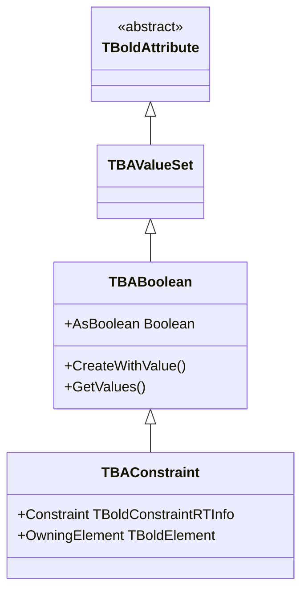

# TBABoolean

`TBABoolean` (unit `BoldAttributes`) stores boolean attribute values. The model types Boolean and Bool map to it. It inherits from `TBAValueSet` (the enumeration base class) rather than directly from `TBoldAttribute`, because a boolean is modeled as a two-value set.

## Class Hierarchy



## Class Definition

```pascal
TBAValueSet = class(TBoldAttribute)
public
  class function GetValues: TBAValueSetValueList; virtual;
  property AsInteger: Integer read GetAsInteger write SetAsInteger;
  property Values: TBAValueSetValueList read GetValues;
end;

TBABoolean = class(TBAValueSet)
public
  constructor CreateWithValue(Value: Boolean);
  class function GetValues: TBAValueSetValueList; override;
  property AsBoolean: Boolean read GetAsBoolean write SetAsBoolean;
end;
```

## Working with TBABoolean

### Reading and Writing

```pascal
// Direct property access
IsActive := Customer.Active;
Customer.Active := True;

// Raw member access
Customer.M_Active.AsBoolean := False;
```

### Null Handling (Three-State)

Boolean attributes can be null (unknown/unset):

```pascal
// Check for null
if Customer.M_Active.IsNull then
  ShowMessage('Active status unknown');

// Set to null (unknown)
Customer.M_Active.SetToNull;
```

### TBAConstraint

`TBAConstraint` is a boolean that evaluates one constraint of the model. You do not declare it as an attribute: the OCL operation `constraints` returns a list of them for an element, one per constraint. `AsBoolean` is True when the constraint holds. This is how `examples/Compound/Invoicing/Tests/InvoicingScenario.pas` checks them:

```pascal
var
  List: TBoldList;
  Constraint: TBAConstraint;
  i: Integer;
begin
  List := Order.EvaluateExpressionAsNewElement('constraints') as TBoldList;
  try
    for i := 0 to List.Count - 1 do
    begin
      Constraint := List[i] as TBAConstraint;
      if not Constraint.AsBoolean then
        ShowMessage('Constraint violated: ' + Constraint.Constraint.ConstraintExpression);
    end;
  finally
    List.Free;
  end;
end;
```

In OCL, `constraints->select(c | not c)->size` counts the broken constraints.

## Common Patterns

### Binding to TBoldCheckBox (VCL)

```pascal
// In the form designer:
// BoldCheckBox1.BoldHandle := a handle whose value is the object
// BoldCheckBox1.BoldProperties.Expression := 'active'
// AllowGrayed := True for nullable booleans; null shows as cbGrayed
```

### OCL Boolean Operations

```
// Filter by boolean attribute
Customer.allInstances->select(active = true)
Customer.allInstances->reject(active)

// Boolean logic
self.active and self.verified
self.active or self.verified
not self.active
```

## See Also

- [TBABoolean reference](../reference/BoldAttributes/TBABoolean.md) - Generated API reference
- [TBoldAttribute](TBoldAttribute.md) - Grandparent class
- [TBoldCheckBox](TBoldCheckBox.md) - VCL control for boolean display
- [TBAString](TBAString.md) - String attribute sibling
