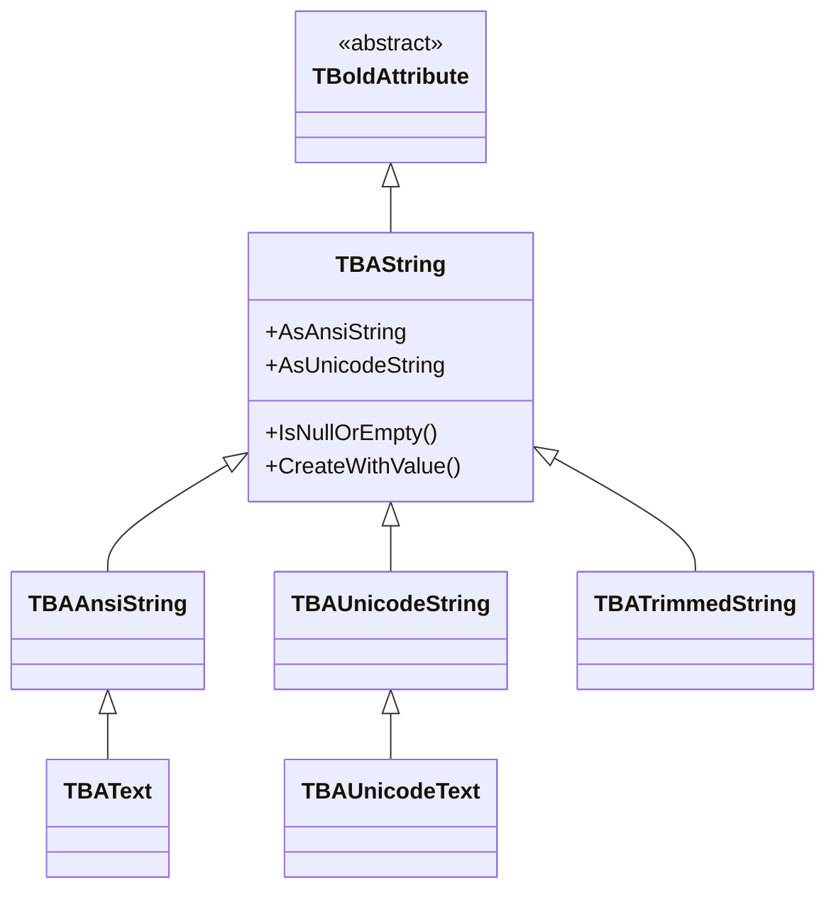

# TBAString

`TBAString` (unit `BoldAttributes`) is the base class for all string attributes in Bold. It stores the compiler's `string` type, which is a Unicode string in Delphi and in Free Pascal (the Lazarus packages compile with `-Mdelphiunicode`). It adds length validation, comparison and null handling.

## Class Hierarchy



## Class Definition

```pascal
TBAString = class(TBoldAttribute)
public
  constructor CreateWithValue(const Value: string);
  procedure Assign(Source: TBoldElement); override;
  function CompareToAs(CompType: TBoldCompareType; BoldElement: TBoldElement): Integer; override;
  function ValidateString(const Value: string; Representation: TBoldRepresentation): Boolean; override;
  function CanSetValue(NewValue: string; Subscriber: TBoldSubscriber): Boolean;
  procedure SetEmptyValue; override;
  function IsNullOrEmpty: Boolean;
  function IsEqualToValue(const Value: IBoldValue): Boolean; override;
  property AsAnsiString: TBoldAnsiString;
  property AsUnicodeString: TBoldUnicodeString;
end;
```

## String Type Variants

| Bold Type | Model Type | Purpose | Length Check |
|-----------|------------|---------|--------------|
| `TBAString` | String, AnsiString | Default string | Model `Length` (-1 = none) |
| `TBAAnsiString` | Not in the default type name dictionary | Rejects characters outside the ANSI code page | Model `Length` |
| `TBAUnicodeString` | UnicodeString | Unicode string column | Model `Length` |
| `TBATrimmedString` | Not in the default type name dictionary | Trims leading and trailing spaces when set through `AsString` | Model `Length` |
| `TBAText` | Text | ANSI text, column type `ColumnTypeForText` | None |
| `TBAUnicodeText` | UnicodeText | Unicode text, column type `ColumnTypeForUnicodeText` | None |

The column types come from the SQL database configuration of the persistence handle.

## Working with TBAString

### Reading and Writing

```pascal
// Direct property access (generated code)
CustomerName := Customer.Name;
Customer.Name := 'Acme Corp';

// Raw member access via M_ prefix
CustomerName := Customer.M_Name.AsString;
```

### Null and Empty Checking

```pascal
// Check for null (no value assigned)
if Customer.M_Name.IsNull then
  ShowMessage('Name not set');

// Check for null OR empty string
if Customer.M_Name.IsNullOrEmpty then
  ShowMessage('Name is missing or blank');

// Set to null
Customer.M_Name.SetToNull;

// Set to empty string (not null)
Customer.M_Name.SetEmptyValue;
```

### Validation

```pascal
// Check if a value can be set (CanSetValue calls the virtual MaySetValue)
if Customer.M_Name.CanSetValue('New Name', nil) then
  Customer.Name := 'New Name';

// ValidateString checks the length against the model's Length
if not Customer.M_Name.ValidateString(NewName, brDefault) then
  ShowMessage('Name is too long');
```

## Common Patterns

### Safe String Access

```pascal
function GetDisplayName(Customer: TCustomer): string;
begin
  if Customer.M_Name.IsNullOrEmpty then
    Result := '(unnamed)'
  else
    Result := Customer.Name;
end;
```

### Trimmed Strings

`TBATrimmedString` removes leading and trailing spaces and control characters when the value is set through `AsString`, which the generated property setter uses. This is useful for name fields where accidental spaces are common.

## See Also

- [TBAString reference](../reference/BoldAttributes/TBAString.md) - Generated API reference
- [TBoldAttribute](TBoldAttribute.md) - Base class
- [TBoldMember](TBoldMember.md) - Member base class
- [TBABlob](TBABlob.md) - For large text, consider blob storage
