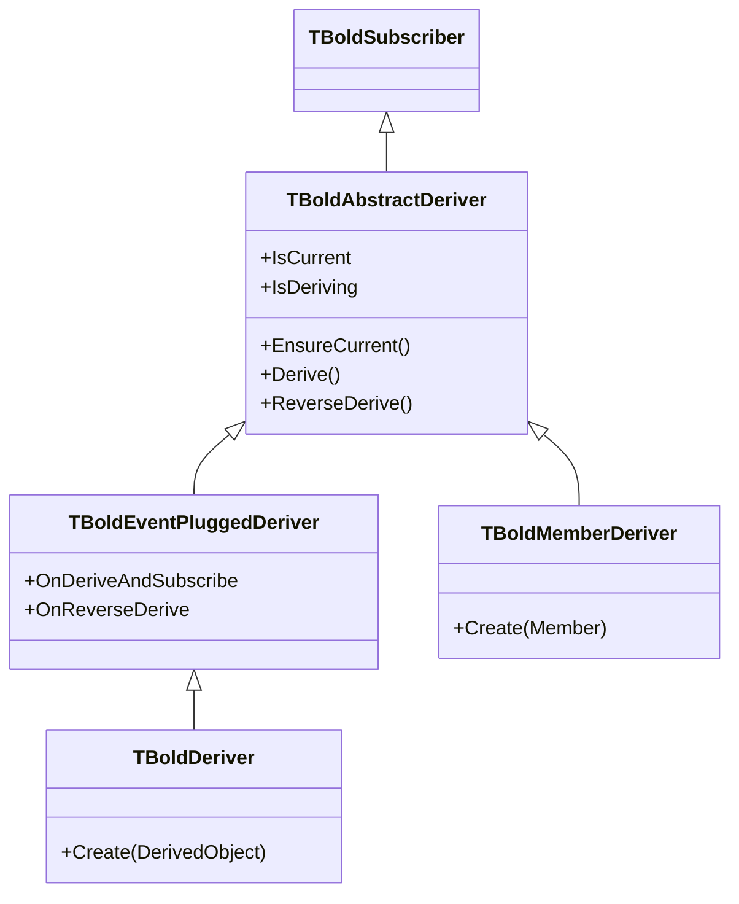
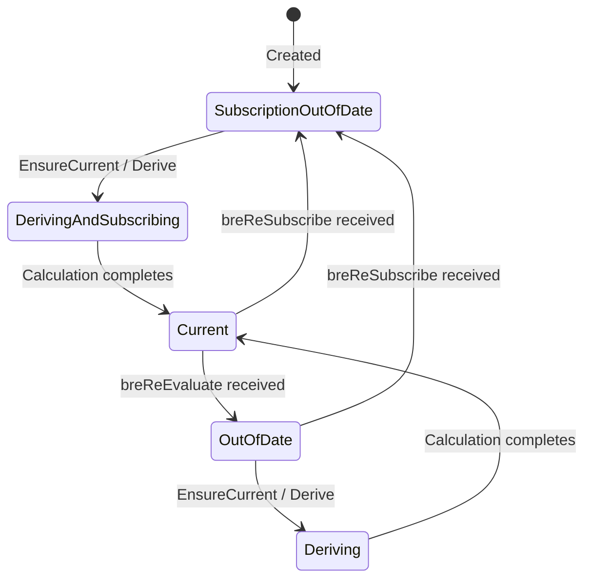

# TBoldAbstractDeriver

`TBoldAbstractDeriver` is the engine behind Bold's derived (calculated) values. It extends `TBoldSubscriber` with a
state for lazy evaluation: a value is calculated when it is read, and calculated again only after something it
depends on has changed. Derived members use the descendant `TBoldMemberDeriver`; `TBoldDeriver` is for your own
derived values.

## Class Hierarchy



## Class Definition

```pascal
TBoldDeriverState = (
  bdsCurrent,                      // Value is up to date
  bdsOutOfDate,                    // Needs recalculation
  bdsSubscriptionOutOfDate,        // Needs recalculation and new subscriptions
  bdsDeriving,                     // Calculating
  bdsDerivingAndSubscribing,       // Calculating and subscribing
  bdsReverseDeriving,              // Pushing a changed value back
  bdsReverseDerivingSubscriptionOutOfDate
);

TBoldAbstractDeriver = class(TBoldSubscriber)
public
  procedure EnsureCurrent;             // Derive if out of date
  procedure Derive;                    // Recalculate now
  procedure ReverseDerive;             // Push a changed value back to its sources
  procedure MarkOutOfDate;             // Mark the value as stale
  procedure MarkSubscriptionOutOfDate; // Mark the subscriptions as stale
  property DerivedObject: TObject;
  property Subscribe: Boolean;
  property IsDeriving: Boolean;
  property IsCurrent: Boolean;
end;

TBoldEventPluggedDeriver = class(TBoldAbstractDeriver)
public
  property OnDeriveAndSubscribe: TBoldDeriveAndResubscribe;
  property OnReverseDerive: TBoldReverseDerive;
  property OnNotifyOutOfDate: TBoldJustNotifyEvent;
end;

TBoldDeriver = class(TBoldEventPluggedDeriver)
public
  constructor Create(DerivedObject: TObject);
end;
```

## How Derivation Works



The derivation cycle:

1. **Reading the value** calls `EnsureCurrent`, which derives when the state is `bdsOutOfDate` or
   `bdsSubscriptionOutOfDate`.
2. **Deriving** calls the derive method. In state `bdsSubscriptionOutOfDate` the deriver first cancels its old
   subscriptions and passes itself as `Subscriber`, so the derive method subscribes to what it reads.
3. **A dependency changes**: a subscription placed with `breReEvaluate` (the default of `DefaultSubscribe`) marks the
   deriver `bdsOutOfDate`. The next read recalculates and keeps the existing subscriptions.
4. **A navigation changes**: a subscription placed with `breReSubscribe` marks the deriver
   `bdsSubscriptionOutOfDate`. The next read recalculates and subscribes again, now to the new objects.

This is **lazy evaluation**: derived values are not recalculated when a dependency changes, only when the value is
next read.

## Working with Derivers

### Code-Derived Members

For a derived attribute without an OCL derivation expression, the code generator declares a derive method in the
business classes; you write its body. The method is named `_<MemberName>_DeriveAndSubscribe`:

```pascal
procedure TOrder._Total_DeriveAndSubscribe(
  DerivedObject: TObject; Subscriber: TBoldSubscriber);
begin
  // Calculate the derived value
  M_Total.AsFloat := Quantity * UnitPrice;

  // Subscribe to the dependencies
  M_Quantity.DefaultSubscribe(Subscriber);
  M_UnitPrice.DefaultSubscribe(Subscriber);
end;
```

When the value depends on a navigated object, subscribe to the link with `breReSubscribe`, so that the
subscriptions move along when the link changes:

```pascal
procedure TPerson._fullName_DeriveAndSubscribe(DerivedObject: TObject; Subscriber: TBoldSubscriber);
begin
  if Assigned(family) then
    M_fullName.AsString := firstName + ' ' + family.familyName
  else
    M_fullName.AsString := firstName;

  M_firstName.DefaultSubscribe(Subscriber);
  M_family.DefaultSubscribe(Subscriber, breReSubscribe);
  if Assigned(family) then
    family.M_familyName.DefaultSubscribe(Subscriber);
end;
```

The second example is from `examples/Simple/ObjectSpace/ReverseDerivedAttributes`.

### Reverse Derivation

Reverse derivation lets the user change a derived value and pushes the change back to its sources. For a member
marked as reverse derived in the model, the code generator also declares `_<MemberName>_ReverseDerive`:

```pascal
procedure TOrder._Total_ReverseDerive(DerivedObject: TObject);
begin
  // The user changed Total: recalculate UnitPrice
  UnitPrice := Total / Quantity;
end;
```

### Deriver in Your Own Code

```pascal
var
  Deriver: TBoldDeriver;
begin
  Deriver := TBoldDeriver.Create(MyObject);
  Deriver.OnDeriveAndSubscribe := MyDeriveProc;      // TBoldDeriveAndResubscribe
  Deriver.OnReverseDerive := MyReverseDeriveProc;    // optional
  // Call Deriver.EnsureCurrent before reading the value; free the deriver when done
end;
```

## Deriver State Reference

| State | Meaning | Entered |
|-------|---------|---------|
| `bdsCurrent` | Value up to date | After a successful derivation |
| `bdsOutOfDate` | Needs recalculation | `breReEvaluate` received, or `MarkOutOfDate` |
| `bdsSubscriptionOutOfDate` | Needs recalculation and new subscriptions | On creation, `breReSubscribe` received, or `MarkSubscriptionOutOfDate` |
| `bdsDeriving` | Calculating | `Derive` from `bdsOutOfDate` |
| `bdsDerivingAndSubscribing` | Calculating and subscribing | `Derive` from `bdsSubscriptionOutOfDate` |
| `bdsReverseDeriving` | Pushing the value back | During `ReverseDerive` |
| `bdsReverseDerivingSubscriptionOutOfDate` | As above, and the subscriptions are stale | `ReverseDerive` from `bdsSubscriptionOutOfDate`, or `breReSubscribe` during `ReverseDerive` |

## See Also

- [TBoldSubscriber](TBoldSubscriber.md) - Base class
- [Derived Attributes](../concepts/derived-attributes.md) - Concept overview
- [Subscriptions](../concepts/subscriptions.md) - Subscription system
