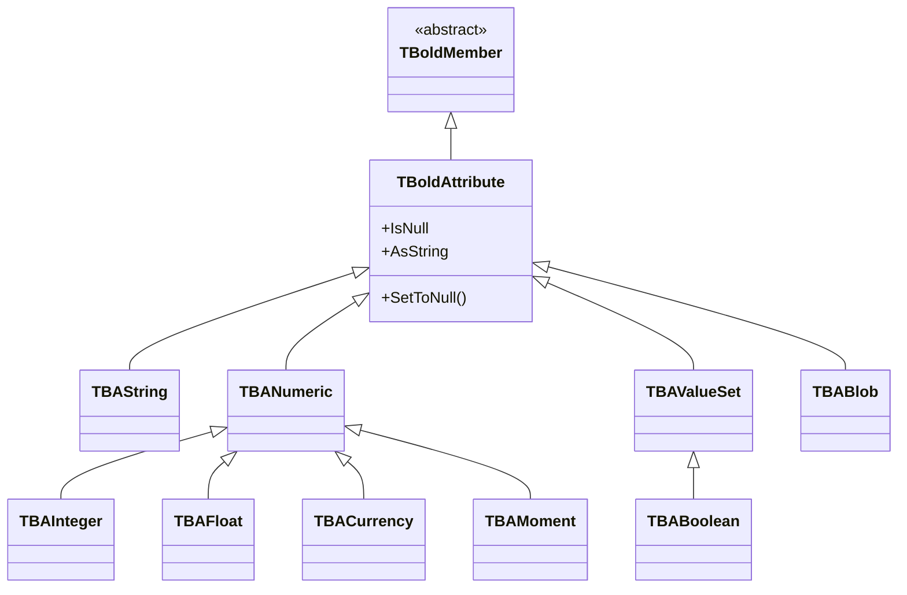

# TBoldAttribute

`TBoldAttribute` (unit `BoldSystem`) is the base class of the members that hold a value. Each attribute type in the model has its own subclass in `BoldAttributes`, such as `TBAString` or `TBAInteger`.

## Class Hierarchy



## Attribute Types

The default type name dictionary maps the model types to these classes:

| Bold Type | Model Type | Value Property | Generated Property Type |
|-----------|------------|----------------|-------------------------|
| [`TBAString`](TBAString.md) | String, AnsiString | `AsString` | `String` |
| [`TBAInteger`](TBAInteger.md) | Integer, Int | `AsInteger` | `Integer` |
| [`TBAFloat`](TBAFloat.md) | Float, Double | `AsFloat` | `Double` |
| [`TBACurrency`](TBACurrency.md) | Currency | `AsCurrency` | `Currency` |
| `TBADateTime` ([`TBAMoment`](TBAMoment.md)) | DateTime, TimeStamp | `AsDateTime` | `TDateTime` |
| `TBADate` ([`TBAMoment`](TBAMoment.md)) | Date | `AsDate` | `TDate` |
| `TBATime` ([`TBAMoment`](TBAMoment.md)) | Time | `AsTime` | `TTime` |
| [`TBABoolean`](TBABoolean.md) | Boolean, Bool | `AsBoolean` | `Boolean` |
| [`TBABlob`](TBABlob.md) | Blob | `AsStream`, `AsString` | `String` |

## Class Definition

Public members, abridged:

```pascal
TBoldAttribute = class(TBoldMember)
public
  // Null handling
  property IsNull: Boolean;
  procedure SetToNull; virtual;
  function CanSetToNull(Subscriber: TBoldSubscriber): Boolean;
  procedure SetEmptyValue; virtual;

  // Value access
  property AsString: string;              // from TBoldElement
  property AsVariant: Variant;            // from TBoldElement

  // Comparison and assignment
  function CompareToAs(CompType: TBoldCompareType; BoldElement: TBoldElement): Integer; override;
  procedure Assign(Source: TBoldElement); override;

  // Metadata
  property BoldAttributeRTInfo: TBoldAttributeRTInfo;
end;
```

The typed value properties (`AsInteger`, `AsFloat`, ...) are declared in the subclasses.

## Working with Attributes

### Reading Values

```pascal
var
  Name: string;
  Age: Integer;
  Salary: Double;
  HireDate: TDateTime;
  Active: Boolean;
begin
  Name := Customer.Name;
  Age := Customer.Age;
  Salary := Employee.Salary;
  HireDate := Employee.HireDate;
  Active := Customer.Active;
end;
```

### Writing Values

```pascal
Customer.Name := 'Acme Corp';
Customer.Age := 25;
Employee.Salary := 50000.00;
Employee.HireDate := Now;
Customer.Active := True;
```

### Null Handling

The typed getters (`AsInteger`, `AsFloat`, `AsBoolean`, `AsDateTime`, ...) raise `EBoldAccessNullValue` when the value is null. `AsString` returns an empty string. `SetToNull` raises unless the model allows null for the attribute (`BoldAttributeRTInfo.AllowNull`).

```pascal
var
  Email: string;
begin
  // Check for null
  if Customer.M_Email.IsNull then
    ShowMessage('No email');

  // Set to null
  Customer.M_Email.SetToNull;

  // Use a default value for null
  if Customer.M_Email.IsNull then
    Email := 'N/A'
  else
    Email := Customer.Email;
end;
```

## Raw Member Access

Use the `M_` property for the attribute object:

```pascal
// Check null state
if Customer.M_Name.IsNull then ...

// Subscribe to changes
Customer.M_Name.DefaultSubscribe(Subscriber);

// Compare attributes
if Customer.M_Name.IsEqual(OtherCustomer.M_Name) then ...
```

## Attribute Metadata

```pascal
var
  Attr: TBoldAttribute;
  Info: TBoldAttributeRTInfo;
begin
  Attr := Customer.M_Name;
  Info := Attr.BoldAttributeRTInfo;

  Log('Name: ' + Info.ExpressionName);
  Log('Type: ' + Info.BoldType.ExpressionName);
  Log('Persistent: ' + BoolToStr(Info.Persistent, True));
  Log('Allows null: ' + BoolToStr(Info.AllowNull, True));
end;
```

## Derived Attributes

A derived attribute with an OCL derivation expression needs no code. For a derived attribute without one, the generated class gets a `_<Member>_DeriveAndSubscribe` method that you implement:

```pascal
procedure TOrder._Total_DeriveAndSubscribe(DerivedObject: TObject;
  Subscriber: TBoldSubscriber);
begin
  // Subscribe to dependencies
  M_Quantity.DefaultSubscribe(Subscriber);
  M_UnitPrice.DefaultSubscribe(Subscriber);

  // Calculate
  M_Total.AsFloat := Quantity * UnitPrice;
end;
```

Bold derives the value again when a dependency changes. AutoSubscription is on by default: Bold subscribes the
derivation to every member the method reads, so the `DefaultSubscribe` calls are needed only in a project that defines
`NoAutoSubscription`. See [Derived Attributes](../concepts/derived-attributes.md#code-derivation).

## Common Patterns

### Safe Value Access

```pascal
function SafeString(Attr: TBAString; const Default: string = ''): string;
begin
  if Attr.IsNull then
    Result := Default
  else
    Result := Attr.AsString;
end;

// Usage
Email := SafeString(Customer.M_Email, 'no-email@example.com');
```

### Format for Display

```pascal
function FormatMoney(Attr: TBAFloat): string;
begin
  if Attr.IsNull then
    Result := '-'
  else
    Result := FormatFloat('$#,##0.00', Attr.AsFloat);
end;
```

### Validate Before Save

```pascal
procedure ValidateCustomer(Customer: TCustomer);
begin
  if Customer.M_Name.IsNull then
    raise Exception.Create('Name is required');

  if Customer.Name.Trim.IsEmpty then
    raise Exception.Create('Name cannot be empty');
end;
```

## See Also

- [TBoldAttribute reference](../reference/BoldSystem/TBoldAttribute.md) - Generated API reference
- [TBoldMember](TBoldMember.md) - Base class
- [TBoldObject](TBoldObject.md) - Attribute owner
- [Subscriptions](../concepts/subscriptions.md) - Reacting to changes
