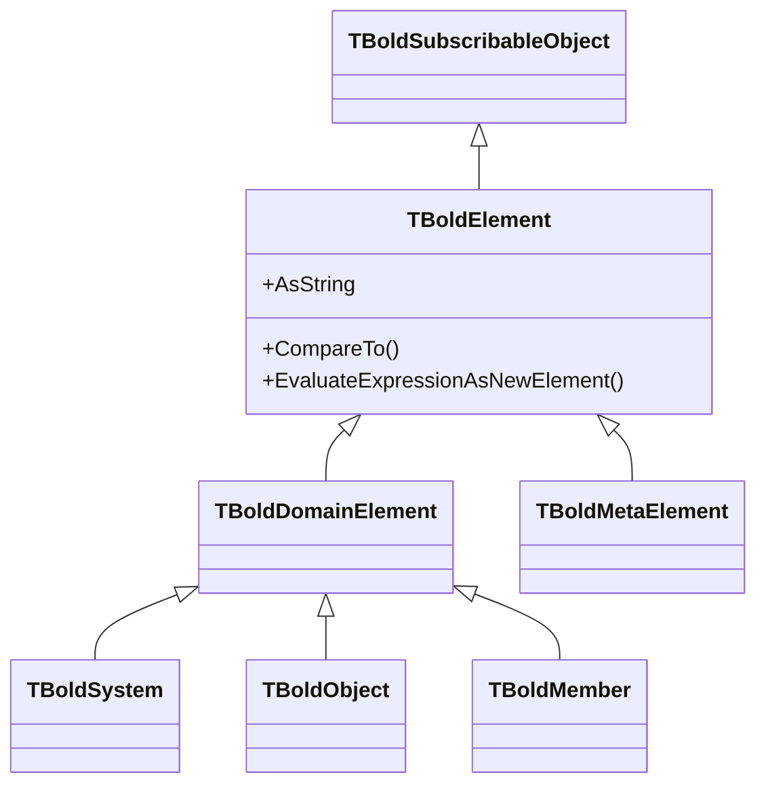

# TBoldElement

`TBoldElement` (unit `BoldElements`) is the abstract base class for everything OCL can evaluate: the object space, objects, members and the runtime type information. It provides string representation, comparison, assignment, OCL evaluation and subscription.

## Class Definition

Public members, abridged:

```pascal
TBoldElement = class(TBoldSubscribableObject)
public
  // String representation
  property AsString: string;                    // StringRepresentation[brDefault]
  property StringRepresentation[Representation: TBoldRepresentation]: string;
  property AsVariant: Variant;
  property DisplayName: string;

  // Comparison
  function CompareTo(BoldElement: TBoldElement): Integer;
  function CompareToAs(CompareType: TBoldCompareType; BoldElement: TBoldElement): Integer; virtual;
  function IsEqual(BoldElement: TBoldElement): Boolean;
  function IsEqualAs(CompareType: TBoldCompareType; BoldElement: TBoldElement): Boolean; virtual;

  // Assignment
  procedure Assign(Source: TBoldElement); virtual;

  // OCL evaluation (optional parameters omitted)
  procedure EvaluateExpression(const Expression: TBoldExpression; ResultElement: TBoldIndirectElement);
  function EvaluateExpressionAsDirectElement(const Expression: TBoldExpression): TBoldElement;
  function EvaluateExpressionAsNewElement(const Expression: TBoldExpression): TBoldElement;
  function EvaluateExpressionAsString(const Expression: TBoldExpression; Representation: TBoldRepresentation = brDefault): string;
  function EvaluateExpressionAsBoolean(const Expression: TBoldExpression): Boolean;
  function EvaluateExpressionAsInteger(const Expression: TBoldExpression): Integer;
  function EvaluateExpressionAsFloat(const Expression: TBoldExpression): Double;
  function EvaluateExpressionAsCurrency(const Expression: TBoldExpression): Currency;
  function EvaluateExpressionAsDateTime(const Expression: TBoldExpression): TDateTime;

  // Type and subscription
  property BoldType: TBoldElementTypeInfo;
  procedure DefaultSubscribe(Subscriber: TBoldSubscriber; RequestedEvent: TBoldEvent = breReEvaluate); virtual; abstract;

  // Mutability
  property Mutable: Boolean;
  procedure MakeImmutable;
end;
```

## Inheritance



## Properties

### AsString

The default string representation (`brDefault`). It is read and write for attributes:

```pascal
var
  Element: TBoldElement;
begin
  ShowMessage(Element.AsString);
end;
```

### DisplayName

A name for log and error messages. For an object it is the class name with the object ID; for a member it is the owning object's display name plus the member's expression name.

```pascal
ShowMessage('Working with: ' + Element.DisplayName);
```

### Mutable

False when the element has been made immutable with `MakeImmutable`. The OCL evaluator does this with the values it computes.

```pascal
if Element.Mutable then
  Element.AsString := 'New Value';
```

## Methods

### CompareTo

Compare two elements:

```pascal
var
  Result: Integer;
begin
  Result := Element1.CompareTo(Element2);
  // Result < 0: Element1 < Element2
  // Result = 0: Element1 = Element2
  // Result > 0: Element1 > Element2
end;
```

### IsEqual

Check equality:

```pascal
if Element1.IsEqual(Element2) then
  ShowMessage('Elements are equal');
```

### Assign

Copy the value from another element. Attributes, references and lists implement it; `TBoldElement.Assign` itself raises `EBold`.

```pascal
TargetElement.Assign(SourceElement);
```

### EvaluateExpression and the typed variants

Evaluate an OCL expression with this element as context. For a scalar result, use the typed function that matches the result type. Each one raises if the result has another type.

```pascal
var
  Customer: TBoldObject;
  OrderCount: Integer;
begin
  OrderCount := Customer.EvaluateExpressionAsInteger('orders->size');
  ShowMessage('Orders: ' + IntToStr(OrderCount));
end;
```

`EvaluateExpressionAsDirectElement` returns an element that already exists, such as a member or an object. It returns nil when the result is a computed value.

### EvaluateExpressionAsNewElement

Evaluate and return an element that the caller owns:

```pascal
var
  Customer: TBoldObject;
  ActiveOrders: TBoldObjectList;
begin
  ActiveOrders := Customer.EvaluateExpressionAsNewElement(
    'self.orders->select(status = ''Active'')'
  ) as TBoldObjectList;
  try
    // Use ActiveOrders
  finally
    ActiveOrders.Free;
  end;
end;
```

## String Representations

`TBoldRepresentation` is an integer. `BoldDefs` defines three constants:

| Constant | Value |
|----------|-------|
| `brDefault` | 1 |
| `brShort` | 2 |
| `brLong` | 3 |

What each representation means depends on the class. For example, `brShort` of a blob attribute is its content type. Read them through the `StringRepresentation` property:

```pascal
var
  ShortName: string;
begin
  ShortName := Element.StringRepresentation[brShort];
end;
```

## Derived Classes

| Class | Parent | Description |
|-------|--------|-------------|
| TBoldDomainElement | `TBoldElement` | Base for the object space, objects and members |
| [TBoldSystem](TBoldSystem.md) | `TBoldDomainElement` | The object space |
| [TBoldObject](TBoldObject.md) | `TBoldDomainElement` | Domain object instances |
| [TBoldMember](TBoldMember.md) | `TBoldDomainElement` | Attributes, references and lists |
| [TBoldAttribute](TBoldAttribute.md) | `TBoldMember` | Simple values |
| [TBoldObjectList](TBoldObjectList.md) | `TBoldList` (a `TBoldMember`) | Collections |
| TBoldMetaElement | `TBoldElement` | Runtime type information, see [TBoldSystemTypeInfo](TBoldSystemTypeInfo.md) |

## See Also

- [TBoldElement reference](../reference/BoldElements/TBoldElement.md) - Generated API reference
- [TBoldDomainElement reference](../reference/BoldDomainElement/TBoldDomainElement.md) - Generated API reference
- [TBoldSystem](TBoldSystem.md) - The object space
- [TBoldObject](TBoldObject.md) - Domain objects
- [Subscriptions](../concepts/subscriptions.md) - Change notification
