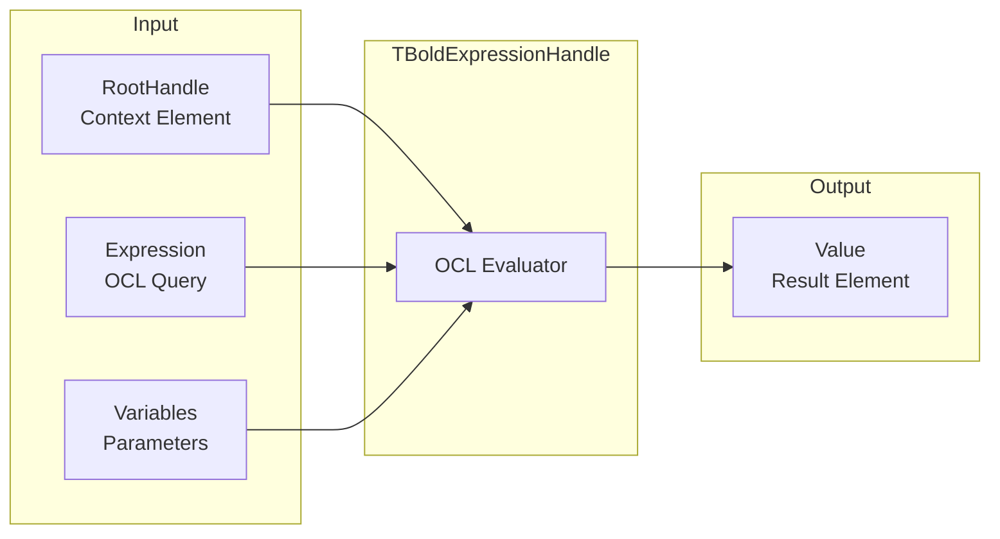

# TBoldExpressionHandle

`TBoldExpressionHandle` evaluates an OCL expression relative to its root handle and holds the single result. Use it
to bind a control to one value, such as an attribute, a calculated value or a related object, or as the root of
other handles.

## Class Definition

```pascal
TBoldExpressionHandle = class(TBoldRootedHandle)
public
  // Core access
  property Value: TBoldElement;

  // Configuration
  property Expression: TBoldExpression;
  property RootHandle: TBoldElementHandle;
  property Variables: TBoldOclVariables;

  // Performance
  property EvaluateInPS: Boolean;          // default False
  property InPSMaxAnswers: Integer;        // default -1 (no limit)
  property InPSOffset: Integer;            // default -1
  property UsePrefetch: Boolean;           // default True

  // Subscription
  property Subscribe: Boolean;             // default True
end;
```

## How It Works



The handle keeps its value until something it subscribed to changes; reading `Value` does not evaluate the
expression again.

## Properties

### Expression

The OCL expression to evaluate:

```pascal
// Simple attribute access
BoldExpressionHandle1.Expression := 'name';

// Calculated value
BoldExpressionHandle1.Expression := 'orders->size';

// Complex expression
BoldExpressionHandle1.Expression := 'orders->select(status = ''Pending'')->collect(total)->sum';
```

### RootHandle

The handle whose value is the context of the expression. With a list handle as root, the context is the list
handle's current element:

```pascal
// Evaluate relative to the selected customer
BoldExpressionHandle1.RootHandle := CustomerListHandle;
BoldExpressionHandle1.Expression := 'orders->size';
```

### Value

The result of the expression:

```pascal
var
  OrderCount: Integer;
begin
  OrderCount := (BoldExpressionHandle1.Value as TBAInteger).AsInteger;
  ShowMessage(Format('Customer has %d orders', [OrderCount]));
end;
```

### Variables

A `TBoldOclVariables` component makes values from other handles available to the expression under a name:

```pascal
// MinAmountHandle is a TBoldVariableHandle with ValueTypeName = 'Integer'
(MinAmountHandle.Value as TBAInteger).AsInteger := 1000;
BoldOclVariables1.AddVariable('minAmount', MinAmountHandle);

BoldExpressionHandle1.Variables := BoldOclVariables1;
BoldExpressionHandle1.Expression := 'orders->select(total > minAmount)->size';
```

### Subscribe

When `True` (the default), the handle subscribes to the values it read and evaluates again when they change:

```pascal
// Evaluate once; do not follow changes
BoldExpressionHandle1.Subscribe := False;
```

### EvaluateInPS

When `True`, the expression is translated to SQL and evaluated in the database (PS = persistent storage) instead of
in memory. The expression must return objects; the value is then an object list. `InPSOffset` skips the first
matches and `InPSMaxAnswers` limits how many of the rest are fetched.

```pascal
// Fetch at most 50 of the active customers
BoldExpressionHandle1.EvaluateInPS := True;
BoldExpressionHandle1.InPSMaxAnswers := 50;
BoldExpressionHandle1.Expression := 'Customer.allInstances->select(active)';
```

## Common Use Cases

### Display Calculated Values

```pascal
// Show the order total
BoldExpressionHandle1.RootHandle := OrderHandle;
BoldExpressionHandle1.Expression := 'items->collect(quantity * unitPrice)->sum';
// Bind to a TBoldEdit or TBoldLabel
```

### Conditional Logic

```pascal
// Does the customer have unpaid orders?
BoldExpressionHandle1.Expression := 'orders->exists(paid = false)';

procedure CheckPaymentStatus;
var
  HasUnpaid: Boolean;
begin
  HasUnpaid := (BoldExpressionHandle1.Value as TBABoolean).AsBoolean;
  if HasUnpaid then
    ShowMessage('Customer has unpaid orders');
end;
```

### Navigation

```pascal
// Get a related object
BoldExpressionHandle1.RootHandle := OrderHandle;
BoldExpressionHandle1.Expression := 'customer';

var
  Customer: TCustomer;
begin
  Customer := BoldExpressionHandle1.Value as TCustomer;
end;
```

### Aggregate Calculations

```pascal
// Sum of all order totals
BoldExpressionHandle1.Expression := 'Order.allInstances->collect(total)->sum';

// Average order value
BoldExpressionHandle1.Expression := 'Order.allInstances->collect(total)->average';

// Count active customers
BoldExpressionHandle1.Expression := 'Customer.allInstances->select(active)->size';
```

## Binding to Controls

In a VCL application, set the `BoldHandle` of a Bold control to the expression handle:

```pascal
// Edit box
BoldEdit1.BoldHandle := BoldExpressionHandle1;

// Label for a calculated value
BoldLabel1.BoldHandle := BoldExpressionHandle1;

// Check box for a Boolean expression
BoldExpressionHandle1.Expression := 'active';
BoldCheckBox1.BoldHandle := BoldExpressionHandle1;
```

## Chaining Handles

```text
BoldSystemHandle1                             // System
  -> BoldListHandle1 (Customer.allInstances)  // All customers
    -> BoldExpressionHandle1 (orders->size)   // Order count of the current customer
```

## Read-Only vs Editable

A calculated result is read-only. An expression that ends in an attribute gives that attribute itself, which a
control can edit:

```pascal
// Editable (simple attribute)
BoldExpressionHandle1.Expression := 'name';

// Read-only (calculated)
BoldExpressionHandle2.Expression := 'firstName + '' '' + lastName';
```

## Performance Tips

1. Set `Subscribe := False` for one-time evaluations.
2. Use `EvaluateInPS := True` to select objects from large tables.

## See Also

- [TBoldListHandle](TBoldListHandle.md) - List expressions
- [TBoldSystemHandle](TBoldSystemHandle.md) - System management
- [OCL Queries](../concepts/ocl.md) - Query language reference
- [TBoldExpressionHandle in the Class Reference](../reference/BoldExpressionHandle/TBoldExpressionHandle.md) - All members (2004 help)
