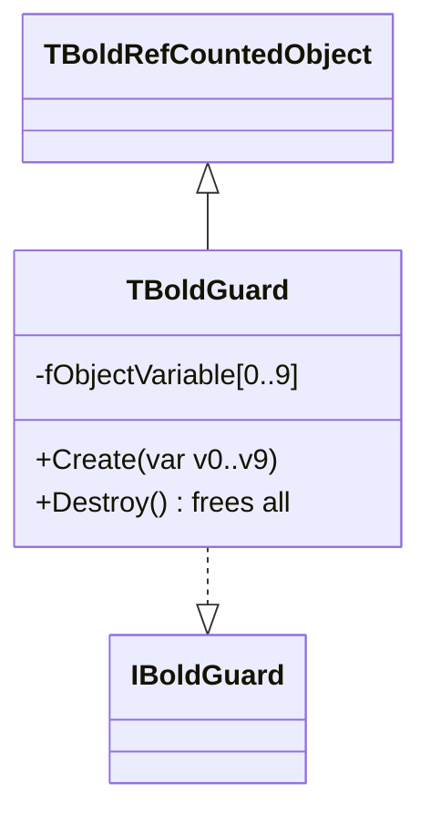

# TBoldGuard

`TBoldGuard` (unit `BoldGuard`) frees local objects automatically through interface reference counting, in Delphi and in Free Pascal. When the guard goes out of scope, it frees all tracked objects, also when an exception occurs.

## Class Hierarchy



## Class Definition

```pascal
IBoldGuard = interface(IUnknown)
end;

TBoldGuard = class(TBoldRefCountedObject, IBoldGuard)
public
  // Overloaded constructors for 1 to 10 variables
  constructor Create(var v0); overload;
  constructor Create(var v0, v1); overload;
  constructor Create(var v0, v1, v2); overload;
  // ... up to 10 variables
  constructor Create(var v0, v1, v2, v3, v4, v5, v6, v7, v8, v9); overload;
  destructor Destroy; override;
end;
```

## How It Works

1. Declare a local `IBoldGuard` variable (interface type)
2. Assign `TBoldGuard.Create(var1, var2, ...)` — constructor sets all variables to `nil`
3. Create objects and assign to the tracked variables
4. When the procedure exits (normally or by exception), the interface ref count drops to 0
5. `Destroy` frees the tracked objects that are not nil, in the order they were passed, and sets the variables to nil

Pass only object variables: the constructor takes untyped `var` parameters and treats each one as a `TObject`.

## Before and After

### Without TBoldGuard

```pascal
procedure ProcessData;
var
  List: TStringList;
  Stream: TFileStream;
  Buffer: TMemoryStream;
begin
  List := nil;
  Stream := nil;
  Buffer := nil;
  try
    List := TStringList.Create;
    Stream := TFileStream.Create('data.txt', fmOpenRead);
    Buffer := TMemoryStream.Create;

    // ... use objects ...

  finally
    Buffer.Free;
    Stream.Free;
    List.Free;
  end;
end;
```

### With TBoldGuard

```pascal
procedure ProcessData;
var
  Guard: IBoldGuard;
  List: TStringList;
  Stream: TFileStream;
  Buffer: TMemoryStream;
begin
  Guard := TBoldGuard.Create(List, Stream, Buffer);
  // All three are now nil and will be freed automatically

  List := TStringList.Create;
  Stream := TFileStream.Create('data.txt', fmOpenRead);
  Buffer := TMemoryStream.Create;

  // ... use objects ...
  // No try/finally needed — Guard frees everything on exit
end;
```

## Common Patterns

### Bold Source Code Usage

Bold's own source uses `TBoldGuard` throughout. This function is from `BoldSystem.pas`:

```pascal
function GetValueFromValuespace(const ValueSpace: IBoldValueSpace; Id: TBoldObjectId; MemberIndex: integer): IBoldValue;
var
  MemberId: TBoldMemberId;
  ObjectContents: IBoldObjectContents;
  G: IBoldGuard;
begin
  G := TBoldGuard.Create(MemberId);
  Result := nil;
  MemberId := TBoldMemberId.Create(MemberIndex);
  ObjectContents := ValueSpace.ObjectContentsByObjectId[Id];
  if Assigned(ObjectContents) then
     Result := ObjectContents.ValueByMemberId[MemberId]
end;  // MemberId is freed here
```

### Maximum 10 Variables

The guard supports up to 10 variables (`MAXARRAY = 9`, zero-indexed). If you need more, use multiple guards or reconsider your design.

```pascal
var
  Guard1, Guard2: IBoldGuard;
  A, B, C, D, E, F, G, H, I, J: TObject;
  K, L: TObject;
begin
  Guard1 := TBoldGuard.Create(A, B, C, D, E, F, G, H, I, J);
  Guard2 := TBoldGuard.Create(K, L);
  // ...
end;
```

!!! tip "Variables are set to nil"
    The constructor sets all passed variables to `nil`. You do not need to initialize them yourself. The destructor frees only the objects that are not nil.

## See Also

- [TBoldSystem](TBoldSystem.md) - The object space (uses guards internally)
- [TBoldElement](TBoldElement.md) - Base element class
