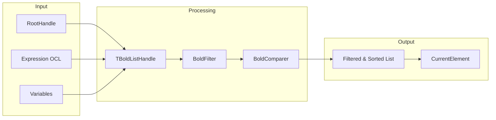

# TBoldListHandle

`TBoldListHandle` holds a list of Bold elements, usually objects, and a current element (a cursor). It evaluates an
OCL expression relative to its root handle, optionally filters and sorts the result, and keeps the list up to date
when the objects change. Grids, navigators and `TBoldDataSet` show their data through list handles.

## Class Definition

```pascal
TBoldListHandle = class(TBoldCursorHandle)
public
  // Core access (from TBoldAbstractListHandle)
  property List: TBoldList;
  property Count: Integer;
  property CurrentElement: TBoldElement;
  property CurrentBoldObject: TBoldObject;
  property CurrentIndex: Integer;
  procedure First;
  procedure Prior;
  procedure Next;
  procedure Last;

  // Configuration
  property Expression: TBoldExpression;
  property RootHandle: TBoldElementHandle;
  property Variables: TBoldOclVariables;
  property MutableListExpression: TBoldExpression;
  property AutoFirst: Boolean;             // default True

  // Processing
  property BoldFilter: TBoldFilter;
  property BoldComparer: TBoldComparer;

  // Performance
  property EvaluateInPS: Boolean;          // default False
  property UsePrefetch: Boolean;           // default True
end;
```

## Component Diagram



## Properties

### Expression and RootHandle

`Expression` is evaluated relative to the value of `RootHandle`. For `allInstances` the root is the system handle;
for a navigation it is the handle of the object to navigate from. The value of a list handle is its current
element, so a list handle can be the root of another handle.

```pascal
// All customers
BoldListHandle1.RootHandle := BoldSystemHandle1;
BoldListHandle1.Expression := 'Customer.allInstances';

// Orders of the current customer of BoldListHandle1
BoldListHandle2.RootHandle := BoldListHandle1;
BoldListHandle2.Expression := 'orders';
```

### Variables

A `TBoldOclVariables` component makes values from other handles available to the expression under a name. Add
the variables at design time in its `Variables` collection (`VariableName` and `BoldHandle`), or in code:

```pascal
// StatusHandle is a TBoldVariableHandle with ValueTypeName = 'String'
StatusHandle.Value.AsString := 'Pending';
BoldOclVariables1.AddVariable('statusVar', StatusHandle);

BoldListHandle1.Variables := BoldOclVariables1;
BoldListHandle1.Expression := 'Order.allInstances->select(status = statusVar)';
```

### BoldFilter

A `TBoldFilter` component removes elements in code. Its `OnFilter` event returns `True` for the elements to keep;
its `OnSubscribe` event subscribes to what the filter reads, so the list is filtered again when that changes.

```pascal
BoldListHandle1.BoldFilter := BoldFilter1;

function TForm1.BoldFilter1Filter(Element: TBoldElement): Boolean;
begin
  Result := (Element as TCustomer).Active;
end;

procedure TForm1.BoldFilter1Subscribe(Element: TBoldElement; Subscriber: TBoldSubscriber);
begin
  (Element as TCustomer).M_Active.DefaultSubscribe(Subscriber);
end;
```

The same filter in OCL: `Customer.allInstances->select(active)`. Prefer OCL when it can express the condition.

### BoldComparer

A `TBoldComparer` component sorts in code. Its `OnCompare` event returns a negative number, zero or a positive
number, like `CompareStr`; it has an `OnSubscribe` event too.

```pascal
BoldListHandle1.BoldComparer := BoldComparer1;

function TForm1.BoldComparer1Compare(Item1, Item2: TBoldElement): Integer;
begin
  Result := CompareStr((Item1 as TCustomer).Name, (Item2 as TCustomer).Name);
end;
```

The same order in OCL: `Customer.allInstances->orderby(name)`, or `->orderdescending(name)`.

### List

The resulting list:

```pascal
var
  i: Integer;
begin
  for i := 0 to BoldListHandle1.Count - 1 do
    ProcessElement(BoldListHandle1.List[i]);
end;
```

### CurrentElement and CurrentIndex

The cursor. With `AutoFirst` (the default) the first element becomes current when the list is evaluated.

```pascal
// Navigate
BoldListHandle1.First;
BoldListHandle1.CurrentIndex := BoldListHandle1.Count - 1;  // last

// Access the current element
var
  Current: TCustomer;
begin
  Current := BoldListHandle1.CurrentElement as TCustomer;
end;
```

### EvaluateInPS

When `True`, the expression is translated to SQL and evaluated in the database (PS = persistent storage) instead of
in memory. Only the matching objects are fetched, which is much faster for large tables. The expression must
return objects, and only the OCL operations that have an SQL translation can be used.

```pascal
// Fetches only the active customers
BoldListHandle1.EvaluateInPS := True;
BoldListHandle1.Expression := 'Customer.allInstances->select(active = true)';

// Without EvaluateInPS all customers are loaded into memory first, then filtered
```

### UsePrefetch

When `True` (the default), the handle fetches the objects the expression navigates in one go before it evaluates
the expression. It only has an effect when Bold is compiled with the `SpanFetch` define, which is off by default
(see `bold.inc`).

## Common Patterns

### Master-Detail

```pascal
// Master: all customers
BoldListHandleCustomers.RootHandle := BoldSystemHandle1;
BoldListHandleCustomers.Expression := 'Customer.allInstances';

// Detail: the orders of the selected customer
BoldListHandleOrders.RootHandle := BoldListHandleCustomers;
BoldListHandleOrders.Expression := 'orders';
```

### Manual Iteration

```pascal
procedure ProcessAllCustomers;
var
  i: Integer;
  Customer: TCustomer;
begin
  for i := 0 to BoldListHandle1.Count - 1 do
  begin
    Customer := BoldListHandle1.List[i] as TCustomer;
    // Process customer
  end;
end;
```

## Connecting to UI

In a VCL application, set the `BoldHandle` property of a [TBoldGrid](TBoldGrid.md) or
[TBoldNavigator](TBoldNavigator.md) to the list handle:

```pascal
BoldGrid1.BoldHandle := BoldListHandle1;
BoldNavigator1.BoldHandle := BoldListHandle1;
```

In FireMonkey (FMX) and Lazarus (LCL) applications, set the `BoldHandle` of a `TBoldDataSet` to the list handle
and bind the dataset with LiveBindings (FMX) or data-aware controls (LCL).

## Performance Tips

1. Use `EvaluateInPS := True` for large tables.
2. Use OCL filters and sorting instead of `TBoldFilter` and `TBoldComparer` when possible.
3. Limit the result with `->subSequence(1, n)` (indexes start at 1).

## See Also

- [TBoldExpressionHandle](TBoldExpressionHandle.md) - Single-value expressions
- [TBoldSystemHandle](TBoldSystemHandle.md) - System management
- [OCL Queries](../concepts/ocl.md) - Query language reference
- [TBoldListHandle in the Class Reference](../reference/BoldListHandle/TBoldListHandle.md) - All members (2004 help)
- [TBoldAbstractListHandle in the Class Reference](../reference/BoldAbstractListHandle/TBoldAbstractListHandle.md) - Cursor members (2004 help)
