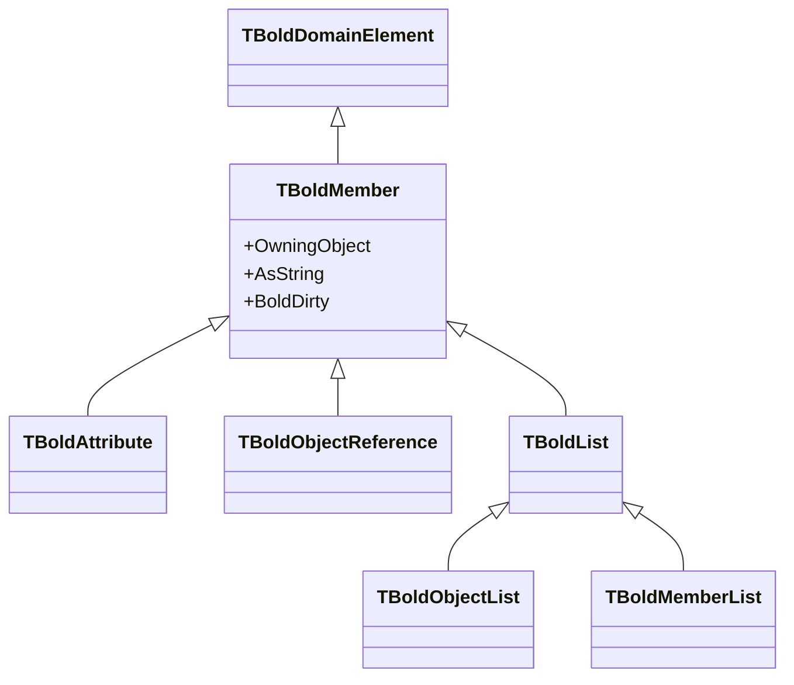

# TBoldMember

`TBoldMember` (unit `BoldSystem`) is the abstract base class for the members of Bold objects: attributes, single references and lists.

## Class Definition

Public members, abridged:

```pascal
TBoldMember = class(TBoldDomainElement)
public
  // Owner and type information
  property OwningObject: TBoldObject;
  property BoldSystem: TBoldSystem;
  property BoldMemberRTInfo: TBoldMemberRTInfo;
  property DisplayName: string;                  // from TBoldElement

  // Value access
  property AsString: string;                     // from TBoldElement

  // State
  property BoldDirty: Boolean;                   // from TBoldDomainElement
  property BoldPersistenceState: TBoldValuePersistenceState;
  property Derived: Boolean;
  property IsReadOnly: Boolean;
  function CanModify: Boolean;
  procedure Invalidate; override;
  procedure EnsureContentsCurrent;

  // Subscriptions
  procedure DefaultSubscribe(Subscriber: TBoldSubscriber; RequestedEvent: TBoldEvent = breReEvaluate); virtual; abstract;
end;
```

`IsNull` belongs to [TBoldAttribute](TBoldAttribute.md), not to `TBoldMember`.

## Inheritance



## Member Types

| Type | Description | Example |
|------|-------------|---------|
| [`TBoldAttribute`](TBoldAttribute.md) | Stores a value | `Customer.Name` |
| [`TBoldObjectReference`](TBoldObjectReference.md) | Single object link | `Order.Customer` |
| [`TBoldObjectList`](TBoldObjectList.md) | Multiple object links | `Customer.Orders` |

## Properties

### OwningObject

The object that owns this member:

```pascal
var
  Member: TBoldMember;
  Owner: TBoldObject;
begin
  Member := Customer.BoldMemberByExpressionName['Name'];
  Owner := Member.OwningObject;  // Returns Customer
end;
```

### AsString

The default string representation:

```pascal
var
  i: Integer;
  Member: TBoldMember;
begin
  for i := 0 to Customer.BoldMemberCount - 1 do
  begin
    Member := Customer.BoldMembers[i];
    Log(Member.DisplayName + ' = ' + Member.AsString);
  end;
end;
```

`DisplayName` includes the owning object. For the member name alone, use `Member.BoldMemberRTInfo.ExpressionName`.

### BoldDirty

Check whether the member has unsaved changes:

```pascal
if Customer.M_Name.BoldDirty then
  HighlightField(NameEdit);
```

## Subscriptions

Members support the subscription pattern:

```pascal
// Subscribe to changes
Customer.M_Name.DefaultSubscribe(MySubscriber);

// When Name changes, the subscriber is notified
```

## Accessing Members

### By Generated Property

```pascal
// Preferred - type safe
CustomerName := Customer.Name;      // string
CustomerOrders := Customer.Orders;  // TOrderList
```

### By Index

```pascal
// Generic access
Member := Customer.BoldMembers[0];
```

### By Name

```pascal
// Dynamic access; raises EBold if the class has no such member
Member := Customer.BoldMemberByExpressionName['Name'];

// Returns nil if the class has no such member
Member := Customer.FindBoldMemberByExpressionName('Name');
```

## Member Naming Convention

Generated code has an `M_` property that returns the member object:

```pascal
TCustomer = class(TBusinessClassesRoot)
private
  function _Get_M_Name: TBAString;
  function _GetName: String;
  procedure _SetName(const NewValue: String);
public
  // Raw member access
  property M_Name: TBAString read _Get_M_Name;

  // Typed value property
  property Name: String read _GetName write _SetName;
end;
```

Use `M_Name` when you need to:
- check `IsNull`
- subscribe to changes
- read metadata through `BoldMemberRTInfo`

## Common Patterns

### Iterate All Members

```pascal
procedure LogAllMembers(Obj: TBoldObject);
var
  i: Integer;
  Member: TBoldMember;
begin
  for i := 0 to Obj.BoldMemberCount - 1 do
  begin
    Member := Obj.BoldMembers[i];
    Log(Format('%s: %s', [Member.DisplayName, Member.AsString]));
  end;
end;
```

### Find Changed Members

```pascal
procedure ListDirtyMembers(Obj: TBoldObject);
var
  i: Integer;
  Member: TBoldMember;
begin
  for i := 0 to Obj.BoldMemberCount - 1 do
  begin
    Member := Obj.BoldMembers[i];
    if Member.BoldDirty then
      Log('Changed: ' + Member.DisplayName);
  end;
end;
```

## See Also

- [TBoldMember reference](../reference/BoldSystem/TBoldMember.md) - Generated API reference
- [TBoldAttribute](TBoldAttribute.md) - Value attributes
- [TBoldObjectList](TBoldObjectList.md) - Multi-valued associations
- [TBoldObject](TBoldObject.md) - Owner of members
- [TBoldMemberRTInfo](TBoldMemberRTInfo.md) - Member metadata
