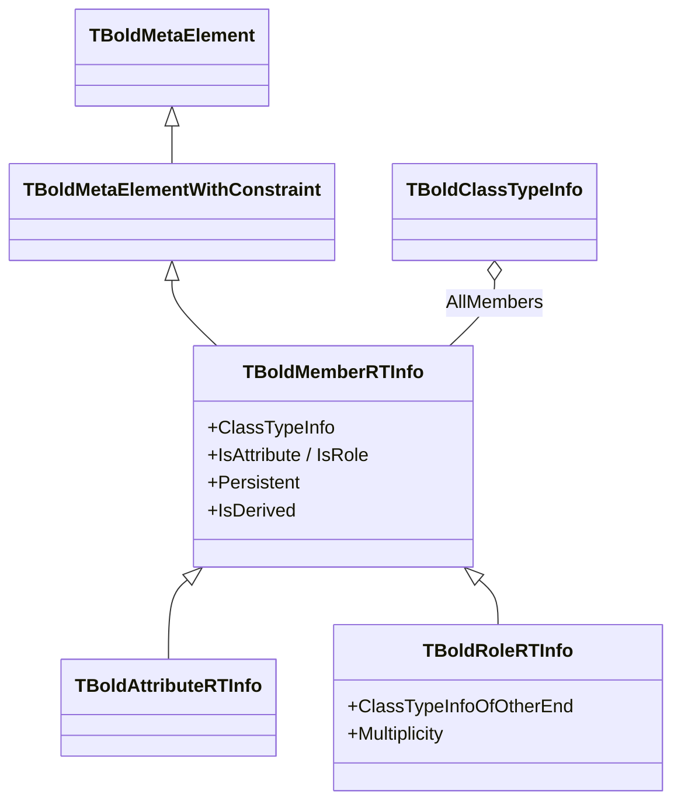

# TBoldMemberRTInfo

`TBoldMemberRTInfo` (unit `BoldSystemRT`) holds runtime metadata for a single member (attribute or association role) of a Bold class. It answers questions like "is this member persistent?", "is it derived?", "what type does it hold?", and "what class owns it?".

## Class Hierarchy



## Class Definition

```pascal
TBoldMemberRTInfo = class(TBoldMetaElementWithConstraint)
public
  // Identity
  property ClassTypeInfo: TBoldClassTypeInfo;   // owning class
  property BoldType: TBoldElementTypeInfo;       // member's type
  property Index: Integer;                       // position in AllMembers
  property StreamName: string;                   // value content name, e.g. 'String' or 'ObjectIdRef'
  property Visibility: TVisibilityKind;

  // Kind flags
  property IsAttribute: Boolean;
  property IsRole: Boolean;
  property IsSingleRole: Boolean;
  property IsMultiRole: Boolean;

  // Behavior flags
  property Persistent: Boolean;
  property IsDerived: Boolean;
  property IsReverseDerived: Boolean;
  property DeriveExpression: string;             // OCL expression for derivation
  property DelayedFetch: Boolean;                // lazy-loaded
  property IsStoredInObject: Boolean;
  property StoreInUndo: Boolean;
  property ToBeRemoved: Boolean;                 // schema evolution
  property Stereotype: string;
end;
```

### TBoldRoleRTInfo (Association Roles)

```pascal
TBoldRoleRTInfo = class(TBoldMemberRTInfo)
public
  // Association navigation
  property ClassTypeInfoOfOtherEnd: TBoldClassTypeInfo;
  property RoleRTInfoOfOtherEnd: TBoldRoleRTInfo;
  property LinkClassTypeInfo: TBoldClassTypeInfo;   // nil if no link class

  // Association metadata
  property RoleType: TBoldRoleType;    // rtRole, rtLinkRole, rtInnerLinkRole
  property Multiplicity: string;       // UML: '0..*', '1', '0..1'
  property Changeability: TChangeableKind;
  property Aggregation: TAggregationKind;
  property DeleteAction: TDeleteAction;

  // Convenience flags
  property IsNavigable: Boolean;
  property IsOrdered: Boolean;
  property Mandatory: Boolean;
  property IsIndirect: Boolean;        // uses link class?
  property Qualifiers: TBoldMemberRTInfoList;
end;
```

### TBoldAttributeRTInfo (Attributes)

```pascal
TBoldAttributeRTInfo = class(TBoldMemberRTInfo)
public
  property AllowNull: Boolean;
  property Length: Integer;            // string length from the model; -1 = no limit
  property InitialValue: string;
  property HasInitialValue: Boolean;
end;
```

## Working with TBoldMemberRTInfo

### Finding Persistent Attributes

```pascal
var
  ClassInfo: TBoldClassTypeInfo;
  i: Integer;
begin
  ClassInfo := SystemTypeInfo.ClassTypeInfoByExpressionName['Customer'];

  for i := 0 to ClassInfo.AllMembersCount - 1 do
  begin
    var Member := ClassInfo.AllMembers[i];
    if Member.IsAttribute and Member.Persistent then
      Log(Format('Persistent attribute: %s (type: %s)',
        [Member.ExpressionName, Member.BoldType.ExpressionName]));
  end;
end;
```

The column names are not part of the runtime type information; the persistence mappers hold them.

### Inspecting Associations

```pascal
var
  Role: TBoldRoleRTInfo;
begin
  for Role in ClassInfo.AllRoles do
  begin
    Log(Format('%s -> %s (%s)', [
      Role.ExpressionName,
      Role.ClassTypeInfoOfOtherEnd.ExpressionName,
      Role.Multiplicity]));

    if Role.IsMultiRole then
      Log('  (collection)');
    if Assigned(Role.LinkClassTypeInfo) then
      Log('  via link class: ' + Role.LinkClassTypeInfo.ExpressionName);
  end;
end;
```

### Checking Derived Members

```pascal
for i := 0 to ClassInfo.AllMembersCount - 1 do
begin
  var Member := ClassInfo.AllMembers[i];
  if Member.IsDerived then
  begin
    Log(Format('Derived: %s = %s',
      [Member.ExpressionName, Member.DeriveExpression]));
    if Member.IsReverseDerived then
      Log('  (reverse derived - a new value is passed to the reverse derive method)');
  end;
end;
```

## See Also

- [TBoldClassTypeInfo](TBoldClassTypeInfo.md) - Owning class info
- [TBoldSystemTypeInfo](TBoldSystemTypeInfo.md) - System-wide type info
- [TBoldAbstractDeriver](TBoldAbstractDeriver.md) - Derivation engine
