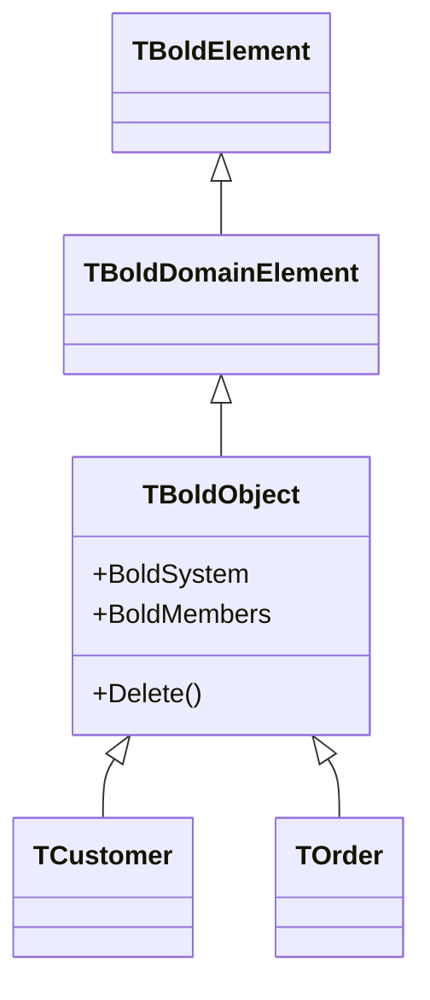
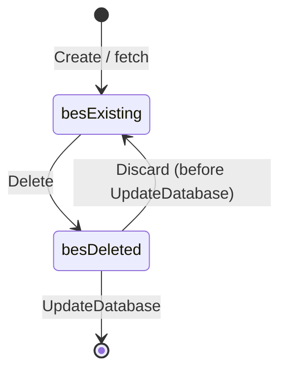

# TBoldObject

`TBoldObject` (unit `BoldSystem`) is the base class for all domain objects in Bold. The business classes that Bold generates from the model inherit from it.

## Class Definition

Public members, abridged:

```pascal
TBoldObject = class(TBoldDomainElement)
public
  constructor Create(AOwningElement: TBoldDomainElement; Persistent: Boolean = True);

  // System and type information
  property BoldSystem: TBoldSystem;
  property BoldClassTypeInfo: TBoldClassTypeInfo;

  // Members
  property BoldMembers[index: Integer]: TBoldMember;
  property BoldMemberCount: Integer;
  property BoldMemberByExpressionName[const name: string]: TBoldMember;   // raises if not found
  function FindBoldMemberByExpressionName(const Name: string): TBoldMember; // nil if not found

  // Identity
  property BoldObjectLocator: TBoldObjectLocator;   // BoldObjectLocator.BoldObjectID is the ID

  // State
  property BoldExistenceState: TBoldExistenceState;
  property BoldPersistenceState: TBoldValuePersistenceState;
  property BoldDirty: Boolean;                       // from TBoldDomainElement
  property BoldObjectIsNew: Boolean;
  property BoldObjectIsDeleted: Boolean;

  // Operations
  procedure Delete;
  function CanDelete: Boolean;
  procedure Discard;
  procedure ReRead;
end;
```

## Inheritance



## Object States

### Existence State

`TBoldExistenceState` is declared in `BoldValueSpaceInterfaces`.



| State | Description |
|-------|-------------|
| `besNotCreated` | Not yet created |
| `besExisting` | The object exists |
| `besDeleted` | Deleted; removed from the database by the next `UpdateDatabase` |

### Persistence State

`TBoldValuePersistenceState` (unit `BoldDefs`) is shared with members:

| State | Description |
|-------|-------------|
| `bvpsCurrent` | In step with the database |
| `bvpsModified` | Changed in memory and not saved. For an object: created or deleted. |
| `bvpsInvalid` | Not loaded; fetched on access |
| `bvpsTransient` | Not persistent; never saved |

A saved object stays `bvpsCurrent` when only its attributes change. Use `BoldDirty` to find unsaved changes.

## Properties

### BoldMembers

Access attributes and references by index:

```pascal
var
  i: Integer;
  Member: TBoldMember;
begin
  for i := 0 to Customer.BoldMemberCount - 1 do
  begin
    Member := Customer.BoldMembers[i];
    Log(Member.DisplayName + ': ' + Member.AsString);
  end;
end;
```

### BoldMemberByExpressionName

Access a member by its expression name:

```pascal
var
  NameAttr: TBoldAttribute;
begin
  NameAttr := Customer.BoldMemberByExpressionName['Name'] as TBoldAttribute;
  NameAttr.AsString := 'New Name';
end;
```

### BoldDirty

Check whether the object has unsaved changes:

```pascal
if Customer.BoldDirty then
  ShowMessage('Customer has unsaved changes');
```

## Methods

### Delete

Delete the object:

```pascal
Customer.Delete;
// A saved object stays in memory as deleted until UpdateDatabase
BoldSystem.UpdateDatabase;
// Now removed from the database
```

A new object that was never saved is destroyed at once. Bold applies the delete action of each association end in the model: `daCascade` deletes the linked objects, `daAllow` unlinks them, and `daProhibit` makes `CanDelete` return False while links exist.

### Discard

Drop the object's unsaved changes. For a deleted object that is not saved yet, `Discard` makes it exist again; a new object is destroyed. `Discard` raises inside an object space transaction.

```pascal
Customer.Delete;
// Changed my mind
Customer.Discard;
```

There is no `Undelete` method. Inside a transaction, `BoldSystem.RollbackTransaction` also restores deleted objects.

## Generated Properties

Code generation creates typed properties for your model:

```pascal
// Generated in the business classes unit
TCustomer = class(TBusinessClassesRoot)
private
  function _Get_M_Name: TBAString;
  function _GetName: String;
  procedure _SetName(const NewValue: String);
  function _GetOrders: TOrderList;
public
  property M_Name: TBAString read _Get_M_Name;
  property M_Orders: TOrderList read _GetOrders;
  property Name: String read _GetName write _SetName;
  property Orders: TOrderList read _GetOrders;
end;
```

Usage:

```pascal
var
  Customer: TCustomer;
  Order: TOrder;
begin
  Customer := TCustomer.Create(BoldSystem);
  Customer.Name := 'Acme Corp';

  for Order in Customer.Orders do
    ProcessOrder(Order);
end;
```

The typed `for..in` loop needs the generated list enumerator, which `bold.inc` enables for Delphi (`UseBoldListEnumerator`).

## Common Patterns

### Check Before Delete

```pascal
procedure SafeDelete(Obj: TBoldObject);
begin
  if (Obj.BoldExistenceState = besExisting) and Obj.CanDelete then
    Obj.Delete;
end;
```

### Clone Object

`TBoldObject` has no clone method. Copy the members you need:

```pascal
function CloneCustomer(Source: TCustomer): TCustomer;
begin
  Result := TCustomer.Create(Source.BoldSystem);
  Result.Name := Source.Name;
  Result.Email := Source.Email;
  // Don't copy ID or references usually
end;
```

### Compare Objects

An object space holds one locator per object, so two references to the same object have the same locator:

```pascal
function SameObject(A, B: TBoldObject): Boolean;
begin
  Result := A.BoldObjectLocator = B.BoldObjectLocator;
end;
```

## See Also

- [TBoldObject reference](../reference/BoldSystem/TBoldObject.md) - Generated API reference
- [TBoldSystem](TBoldSystem.md) - The object space
- [TBoldMember](TBoldMember.md) - Attributes and references
- [TBoldObjectList](TBoldObjectList.md) - Collections
- [TBoldObjectId](TBoldObjectId.md) - Object identity
