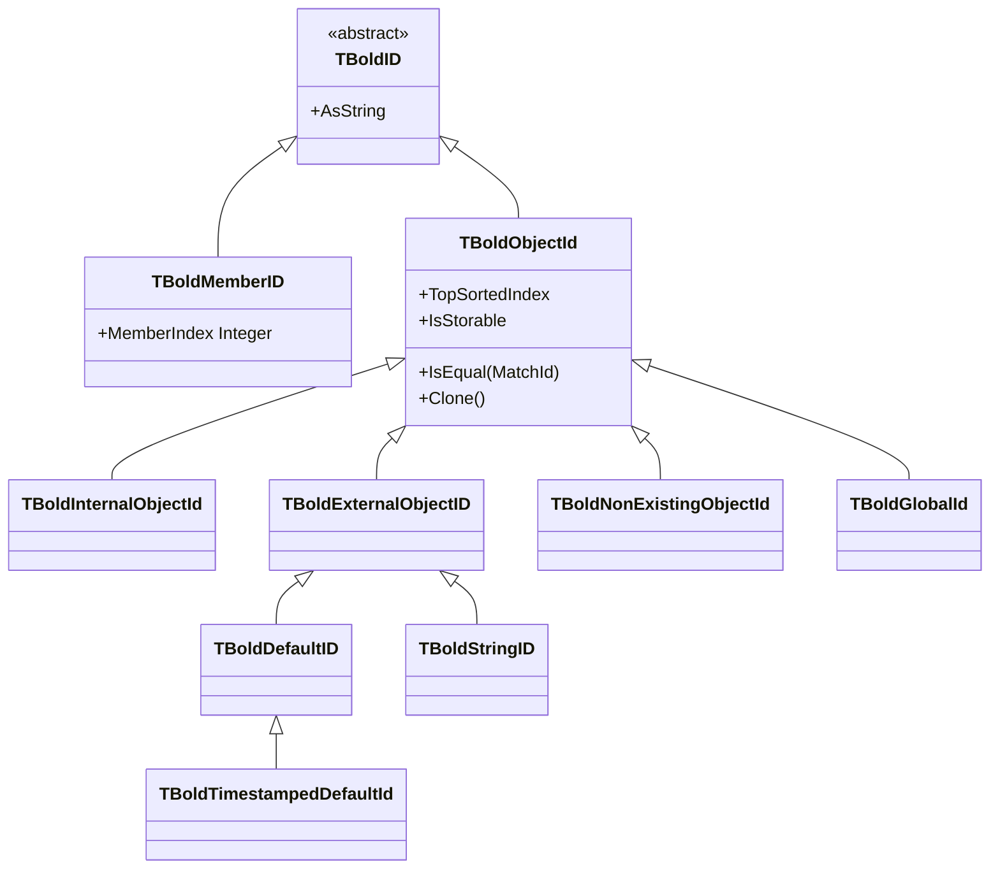

# TBoldObjectId

`TBoldObjectId` (unit `BoldId`) is the abstract base class for object identity in Bold. Every object has an ID. A saved object has a storable ID that stays the same across sessions; Bold uses it for database storage and object lookup.

## Class Hierarchy



## Class Definition

```pascal
TBoldID = class(TBoldNonRefCountedObject, IBoldStreamable)
public
  property AsString: string;
end;

TBoldMemberID = class(TBoldID)
public
  constructor Create(MemberIndex: Integer);
  property MemberIndex: Integer;
end;

TBoldObjectId = class(TBoldID)
public
  constructor CreateWithClassID(TopSortedIndex: Integer; Exact: Boolean); virtual;
  function Clone: TBoldObjectId;
  function CloneWithClassId(TopSortedIndex: Integer; Exact: Boolean): TBoldObjectId; virtual; abstract;
  property TopSortedIndex: Integer;      // class type reference
  property TopSortedIndexExact: Boolean; // exact class or could be subclass?
  property IsStorable: Boolean;          // can be persisted?
  property IsEqual[MatchId: TBoldObjectId]: Boolean;
  property NonExisting: Boolean;
  property Hash: Cardinal;
  property TimeStamp: TBoldTimeStampType;
end;

TBoldDefaultID = class(TBoldExternalObjectID)   // unit BoldDefaultId
public
  property AsInteger: Integer;
end;
```

## ID Types

| Type | Unit | Purpose | `IsStorable` |
|------|------|---------|--------------|
| `TBoldInternalObjectId` | `BoldId` | Temporary ID of an object that is not saved yet | False |
| `TBoldDefaultID` | `BoldDefaultId` | Integer ID from the database (`AsInteger`) | True |
| `TBoldTimestampedDefaultId` | `BoldDefaultId` | `TBoldDefaultID` plus a timestamp, for an object read at a point in time (versioning) | True |
| `TBoldStringID` | `BoldStringId` | External ID with a string value | True |
| `TBoldGlobalId` | `BoldGlobalId` | Global ID string plus the class expression name | False |
| `TBoldNonExistingObjectId` | `BoldId` | Refers to an object that does not exist (`NonExisting` is True) | False |

## Working with Object IDs

### Accessing an Object's ID

```pascal
var
  ObjectId: TBoldObjectId;
  IdString: string;
begin
  ObjectId := Customer.BoldObjectLocator.BoldObjectID;
  IdString := ObjectId.AsString;
  // e.g. "42" for a TBoldDefaultID
end;
```

### Looking Up Objects by ID

```pascal
var
  Locator: TBoldObjectLocator;
  Customer: TCustomer;
begin
  // Only objects that are already loaded; nil otherwise
  Locator := BoldSystem.Locators.LocatorByID[SomeObjectId];
  if Assigned(Locator) and Assigned(Locator.BoldObject) then
    Customer := Locator.BoldObject as TCustomer;

  // Fetches the object from the database when needed
  Customer := BoldSystem.EnsuredLocatorByID[SomeObjectId].EnsuredBoldObject as TCustomer;
end;
```

### TopSortedIndex

The `TopSortedIndex` links the ID to a class in the model's type hierarchy. Classes are sorted topologically (superclasses before subclasses). When `TopSortedIndexExact` is `True`, the ID refers to exactly that class; when `False`, it could be any subclass.

### TBoldMemberID

`TBoldMemberID` identifies a specific member (attribute or role) within an object, by its index in the class's member list.

```pascal
var
  MemberId: TBoldMemberID;
begin
  MemberId := TBoldMemberID.Create(0);  // first member
  try
    // Used internally for persistence operations
  finally
    MemberId.Free;
  end;
end;
```

## See Also

- [TBoldObject](TBoldObject.md) - Domain objects that have IDs
- [TBoldSystem](TBoldSystem.md) - The object space, with locator lookup
- [TBoldObjectLocator reference](../reference/BoldSystem/TBoldObjectLocator.md) - Generated API reference for the locator
- [Persistence](../concepts/persistence.md) - Database mapping
