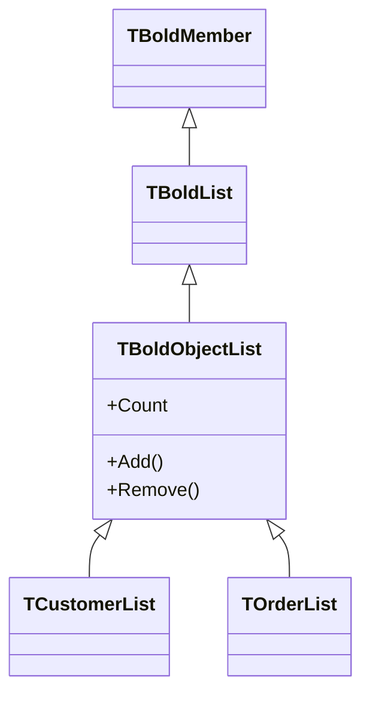

# TBoldObjectList

`TBoldObjectList` (unit `BoldSystem`) is a list of Bold objects. Bold uses it for multi-valued association ends (one-to-many, many-to-many), for class extents (`allInstances`) and for OCL results.

## Class Definition

Public members, abridged. Several come from `TBoldList`:

```pascal
TBoldObjectList = class(TBoldList)
public
  // Access
  property BoldObjects[index: Integer]: TBoldObject; default;
  property Count: Integer;
  property First: TBoldObject;
  property Last: TBoldObject;
  property Locators[index: Integer]: TBoldObjectLocator;

  // Modification
  procedure Add(BoldObject: TBoldObject);
  function AddNew: TBoldElement;
  procedure Insert(index: Integer; BoldObject: TBoldObject);
  procedure Remove(Item: TBoldElement; ARaiseIfNotFound: Boolean = True);
  procedure RemoveByIndex(index: Integer);
  procedure Clear;
  procedure Move(CurIndex, NewIndex: Integer);

  // Query
  function IndexOf(BoldObject: TBoldObject): Integer;
  function Includes(BoldObject: TBoldObject): Boolean;
  property Empty: Boolean;

  // Iteration
  function GetEnumerator: TBoldObjectListEnumerator;
end;
```

## Inheritance



The generated lists inherit from the list class of the model's root class, which inherits from `TBoldObjectList`.

## Properties

### BoldObjects / Count

Access elements by index:

```pascal
var
  i: Integer;
  Customer: TCustomer;
begin
  for i := 0 to CustomerList.Count - 1 do
  begin
    Customer := CustomerList.BoldObjects[i] as TCustomer;
    ProcessCustomer(Customer);
  end;
end;
```

### First / Last

The first and last element:

```pascal
var
  FirstCustomer: TCustomer;
begin
  if CustomerList.Count > 0 then
    FirstCustomer := CustomerList.First as TCustomer;
end;
```

## Methods

### Add

Add an object to the list:

```pascal
var
  Order: TOrder;
begin
  Order := TOrder.Create(BoldSystem);
  Customer.Orders.Add(Order);
  // Order is now linked to Customer
end;
```

### Remove

Remove an object from the list:

```pascal
Customer.Orders.Remove(SomeOrder);
// The object still exists, just not in this list
```

`Remove` raises when the object is not in the list, unless `ARaiseIfNotFound` is False.

### Clear

Remove all objects:

```pascal
Customer.Orders.Clear;
// All orders unlinked from customer
```

### IndexOf / Includes

Check membership:

```pascal
var
  Index: Integer;
begin
  if Customer.Orders.Includes(AnOrder) then
    ShowMessage('Order belongs to this customer');

  Index := Customer.Orders.IndexOf(AnOrder);
  if Index >= 0 then
    ShowMessage('Found at index ' + IntToStr(Index));
end;
```

## Iteration

### For-In Loop

```pascal
var
  Order: TOrder;
begin
  for Order in Customer.Orders do
    ProcessOrder(Order);
end;
```

A typed loop variable needs the enumerator of the generated list, which `bold.inc` enables for Delphi (`UseBoldListEnumerator`). On a plain `TBoldObjectList`, the loop variable is a `TBoldObject`.

### Traditional Loop

```pascal
var
  i: Integer;
begin
  for i := 0 to Customer.Orders.Count - 1 do
    ProcessOrder(Customer.Orders[i]);
end;
```

### Reverse Iteration (for removal)

```pascal
var
  i: Integer;
begin
  for i := Customer.Orders.Count - 1 downto 0 do
    if ShouldRemove(Customer.Orders[i]) then
      Customer.Orders.RemoveByIndex(i);
end;
```

## Generated Typed Lists

Code generation creates a typed list class for each class in the model:

```pascal
// Generated in the business classes unit
TOrderList = class(TBusinessClassesRootList)
protected
  function GetBoldObject(index: Integer): TOrder;
  procedure SetBoldObject(index: Integer; NewObject: TOrder);
public
  function GetEnumerator: TOrderListEnumerator;  // {$IFDEF UseBoldListEnumerator}
  function Includes(anObject: TOrder): Boolean;
  function IndexOf(anObject: TOrder): Integer;
  procedure Add(NewObject: TOrder);
  function AddNew: TOrder;
  procedure Insert(index: Integer; NewObject: TOrder);
  property BoldObjects[index: Integer]: TOrder read GetBoldObject write SetBoldObject; default;
end;
```

Usage:

```pascal
var
  Order: TOrder;
begin
  // Type-safe access
  Order := Customer.Orders[0];               // Returns TOrder, not TBoldObject
  Order := Customer.Orders.AddNew;           // Creates a new TOrder in the list
  Order := Customer.Orders.First as TOrder;  // First and Last are not typed
end;
```

## Standalone Lists

`TBoldObjectList.Create` makes a list that no object owns, for example for a selection. The caller frees it. Adding an object to it does not link anything.

## Common Patterns

### Filter List

```pascal
function GetPaidOrders(Orders: TOrderList): TBoldObjectList;
begin
  // The caller frees the result
  Result := Orders.EvaluateExpressionAsNewElement(
    'self->select(paid = true)') as TBoldObjectList;
end;
```

### Sum Values

```pascal
function TotalOrderValue(Orders: TOrderList): Currency;
var
  Order: TOrder;
begin
  Result := 0;
  for Order in Orders do
    Result := Result + Order.Total;
end;

// Or with OCL (Total is a Currency attribute)
function TotalOrderValueOCL(Orders: TOrderList): Currency;
begin
  Result := Orders.EvaluateExpressionAsCurrency('self->collect(total)->sum');
end;
```

### Copy to a Generic List

```pascal
function ToGenericList(BoldList: TBoldObjectList): TList<TBoldObject>;
var
  i: Integer;
begin
  Result := TList<TBoldObject>.Create;
  for i := 0 to BoldList.Count - 1 do
    Result.Add(BoldList.BoldObjects[i]);
end;
```

## See Also

- [TBoldObjectList reference](../reference/BoldSystem/TBoldObjectList.md) - Generated API reference
- [TBoldList reference](../reference/BoldSystem/TBoldList.md) - Generated API reference for the base class
- [TBoldObject](TBoldObject.md) - Elements in the list
- [TBoldMember](TBoldMember.md) - Base class
- [OCL Queries](../concepts/ocl.md) - Query collections
