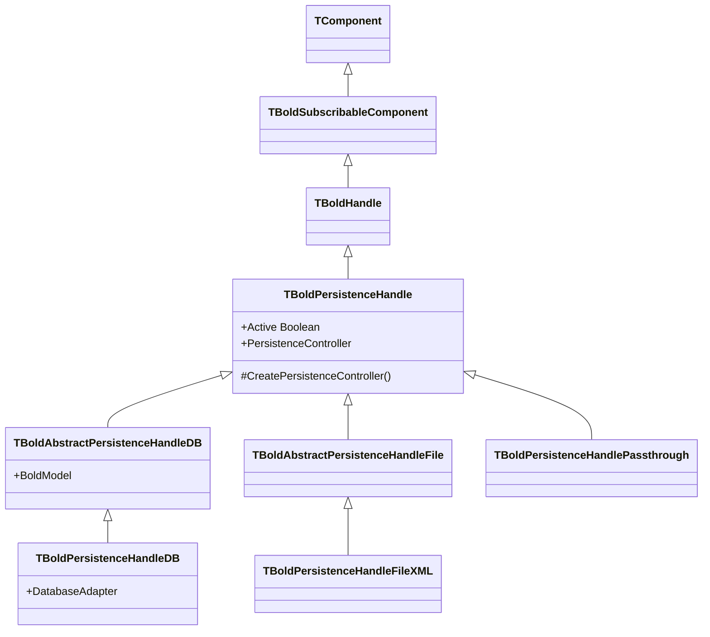
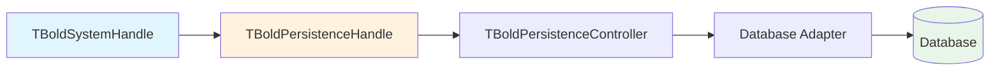

# TBoldPersistenceHandle

`TBoldPersistenceHandle` is the abstract base component that connects the object space to a persistence layer: a
database, an XML file or another persistence handle. You do not drop a `TBoldPersistenceHandle` itself but one of its
descendants, and point `TBoldSystemHandle.PersistenceHandle` to it.

## Class Hierarchy



## Class Definition

```pascal
TBoldPersistenceHandle = class(TBoldHandle)
protected
  function CreatePersistenceController: TBoldPersistenceController; virtual; abstract;
  function GetActive: Boolean; virtual;
  procedure SetActive(Value: Boolean); virtual;
public
  constructor Create(Owner: TComponent); override;
  destructor Destroy; override;
  procedure ReleasePersistenceController;
  procedure AddPersistenceSubscription(Subscriber: TBoldSubscriber;
    Events: TBoldSmallEventSet = []); virtual;
  property Active: Boolean read GetActive write SetActive;
  property PersistenceController: TBoldPersistenceController;
end;
```

## Connection Architecture



The `PersistenceController` is created on first access, by the abstract `CreatePersistenceController` method that
each descendant implements.

## Concrete Implementations

| Class | Purpose | Storage |
|-------|---------|----------|
| `TBoldPersistenceHandleDB` | SQL database persistence through a database adapter | Any supported SQL database |
| `TBoldPersistenceHandleFileXML` | XML file persistence | A file |
| `TBoldPersistenceHandlePassthrough` | Base class for handles that pass the calls on to `NextPersistenceHandle` | N/A |

## Working with TBoldPersistenceHandle

### Form Designer Setup (Database)

1. Drop a `TBoldPersistenceHandleDB` on a data module.
2. Set `BoldModel` to your model component.
3. Set `DatabaseAdapter` to a database adapter: `TBoldDatabaseAdapterFireDAC` (recommended in Delphi),
   `TBoldDatabaseAdapterUniDAC` or `TBoldDatabaseAdapterZeos` (Free Pascal).
4. Set `TBoldSystemHandle.PersistenceHandle` to this component.

### Activation

`TBoldSystemHandle` activates its persistence handle when it is activated itself. In code:

```pascal
// Activate the persistence connection
PersistenceHandle.Active := True;

// Deactivate (sends beDeactivating, releases the controller)
PersistenceHandle.Active := False;
```

### Subscribing to Persistence Events

`AddPersistenceSubscription` passes the controller's persistence events on to a subscriber. With an empty set the
subscriber gets all of them. Persistence event numbers overlap object event numbers (`bpeStartFetch` and
`beMemberChanged` are both 1), so give persistence events a subscriber of their own.

```pascal
// Monitor persistence operations (fetch, update, etc.)
PersistenceHandle.AddPersistenceSubscription(MySubscriber,
  [bpeStartFetch, bpeEndFetch, bpeStartUpdate, bpeEndUpdate]);
```

### Persistence Event Constants

| Event | Meaning |
|-------|---------|
| `bpeStartFetch` | Fetch operation starting |
| `bpeEndFetch` | Fetch operation complete |
| `bpeStartUpdate` | Database update starting |
| `bpeEndUpdate` | Database update complete |
| `bpeFetchObject` | Single object fetched |
| `bpeUpdateObject` | Single object updated |
| `bpeDeleteObject` | Object deleted from DB |
| `bpeCreateObject` | Object created in DB |

## See Also

- [TBoldSystemHandle](TBoldSystemHandle.md) - References the persistence handle
- [TBoldSystem](TBoldSystem.md) - The object space
- [Persistence](../concepts/persistence.md) - Persistence concepts
