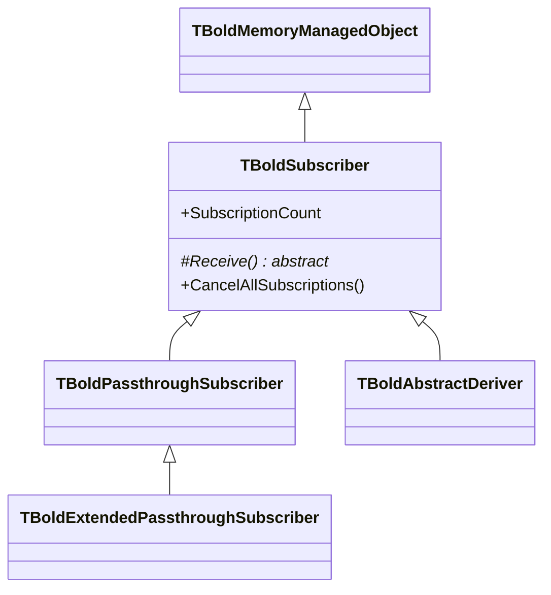
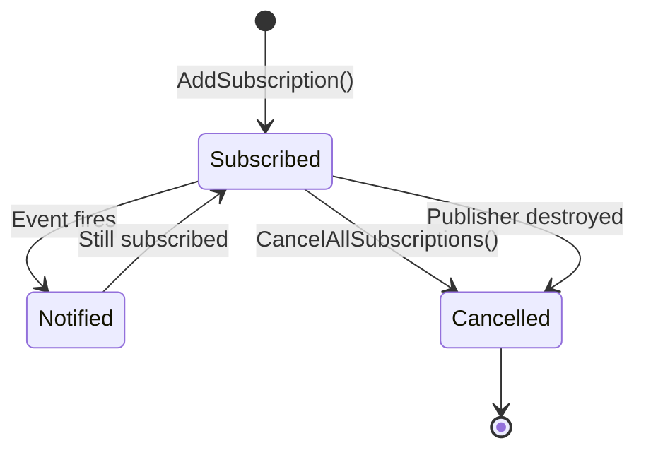

# TBoldSubscriber

`TBoldSubscriber` is the abstract receiver side of Bold's subscription (observer) pattern. It receives events from
publishers and keeps track of its own subscriptions. Application code uses a descendant, usually
`TBoldPassthroughSubscriber`.

## Class Hierarchy



## Class Definition

```pascal
TBoldSubscriber = class(TBoldMemoryManagedObject)
protected
  // MUST override in descendants
  procedure Receive(Originator: TObject; OriginalEvent: TBoldEvent;
    RequestedEvent: TBoldRequestedEvent); virtual; abstract;

  // Optional overrides
  procedure ReceiveExtended(Originator: TObject; OriginalEvent: TBoldEvent;
    RequestedEvent: TBoldRequestedEvent; const Args: array of const); virtual;
  function Answer(Originator: TObject; OriginalEvent: TBoldEvent;
    RequestedEvent: TBoldRequestedEvent; const Args: array of const;
    Subscriber: TBoldSubscriber): Boolean; virtual;
public
  procedure CancelAllSubscriptions;
  function HasMatchingSubscription(APublisher: TBoldPublisher): Boolean;
  procedure CancelSubscriptionTo(APublisher: TBoldPublisher);
  property SubscriptionCount: Integer;
  property SubscriptionsAsText: string; // debug
end;
```

## Key Concepts

### Abstract: Use Descendants

| Class | Use Case |
|-------|----------|
| [TBoldPassthroughSubscriber](TBoldPassthroughSubscriber.md) | Passes events on to a method |
| [TBoldAbstractDeriver](TBoldAbstractDeriver.md) | Automatic value derivation |
| Custom subclass | Complex subscription logic |

### Receive Method

`Receive` is called when a subscribed event fires:

- **Originator**: the object that sent the event
- **OriginalEvent**: the event that occurred (e.g. `beValueChanged`)
- **RequestedEvent**: the value passed as `RequestedEvent` when the subscription was placed; use it to route
  events from several subscriptions

### Subscription Lifecycle



Subscriptions are cleaned up automatically when either side is destroyed: freeing a subscriber cancels its
subscriptions, and a Bold object, member or handle clears the subscriptions to its publisher when it is freed.

## Common Patterns

### Custom Subscriber

```pascal
type
  TMySubscriber = class(TBoldSubscriber)
  protected
    procedure Receive(Originator: TObject; OriginalEvent: TBoldEvent;
      RequestedEvent: TBoldRequestedEvent); override;
  end;

procedure TMySubscriber.Receive(Originator: TObject;
  OriginalEvent: TBoldEvent; RequestedEvent: TBoldRequestedEvent);
begin
  // Subscribed with Member.DefaultSubscribe(MySubscriber) (requests beValueChanged)
  // and Obj.AddSmallSubscription(MySubscriber, [beDestroying], beDestroying)
  case RequestedEvent of
    beValueChanged: HandleValueChange(Originator);
    beDestroying: HandleDestroyed(Originator);
  end;
end;
```

### Cleanup

Freeing the subscriber is enough; `TBoldSubscriber.BeforeDestruction` calls `CancelAllSubscriptions`.

```pascal
destructor TMyComponent.Destroy;
begin
  fSubscriber.Free; // also cancels its subscriptions
  inherited;
end;
```

## See Also

- [TBoldPublisher](TBoldPublisher.md) - The sender side
- [TBoldPassthroughSubscriber](TBoldPassthroughSubscriber.md) - Concrete subscriber
- [TBoldAbstractDeriver](TBoldAbstractDeriver.md) - Derivation subscriber
- [Subscriptions](../concepts/subscriptions.md) - Concept overview
- [TBoldSubscriber in the Class Reference](../reference/BoldSubscription/TBoldSubscriber.md) - All members (2004 help)
