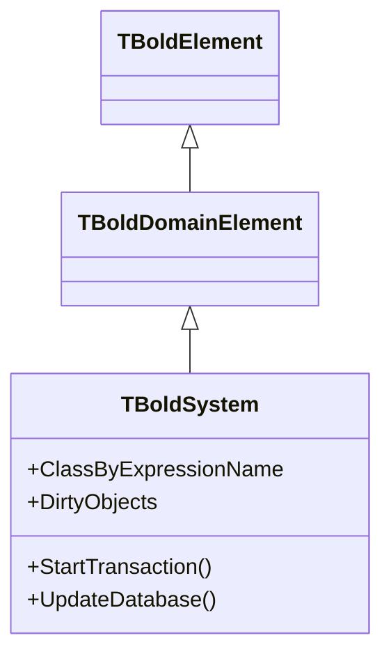

# TBoldSystem

`TBoldSystem` (unit `BoldSystem`) is the **object space**: the in-memory graph of all domain objects. It creates and locates objects, tracks unsaved changes, runs object space transactions and saves to the database through its persistence controller. An application normally gets it from a `TBoldSystemHandle`.

## Class Definition

Public members, abridged:

```pascal
TBoldSystem = class(TBoldDomainElement)
public
  // Class extents (all instances of a class)
  property ClassByExpressionName[const ExpressionName: string]: TBoldObjectList;
  property ClassByObjectClass[ObjectClass: TBoldObjectClass]: TBoldObjectList;
  property Classes[index: Integer]: TBoldObjectList;   // index = TopSortedIndex
  property BoldSystemTypeInfo: TBoldSystemTypeInfo;

  // Creating and locating objects
  function CreateNewObjectByExpressionName(const ExpressionName: string; Persistent: Boolean = True): TBoldObject;
  function CreateNewObjectFromClassTypeInfo(aClassTypeInfo: TBoldClassTypeInfo; Persistent: Boolean = True): TBoldObject;
  property Locators: TBoldSystemLocatorList;
  property EnsuredLocatorByID[ObjectID: TBoldObjectId]: TBoldObjectLocator;

  // Unsaved changes
  property DirtyObjects: TList;                        // of TBoldObject
  property DirtyObjectsAsBoldList: TBoldObjectList;    // new list, the caller frees it
  property BoldDirty: Boolean;                         // from TBoldDomainElement

  // Object space transactions
  procedure StartTransaction(MinimalMode: TBoldSystemTransactionMode = stmNormal);
  procedure CommitTransaction(MinimalMode: TBoldSystemTransactionMode = stmNormal);
  procedure RollbackTransaction(MinimalMode: TBoldSystemTransactionMode = stmNormal);
  function InTransaction: Boolean;

  // Persistence
  procedure UpdateDatabase;
  procedure UpdateDatabaseWithList(ObjectList: TBoldObjectList);
  procedure FetchMembersWithObjects(aBoldObjectList: TBoldObjectList; const AMemberCommaList: string); overload;
  procedure Discard; override;

  // Events
  property OnPreUpdate: TNotifyEvent;
  property OnOptimisticLockingFailed: TBoldOptimisticLockingFailedEvent;
  property OnCreateApproximateObjectError: TBoldCreateApproximateObjectError;
end;
```

OCL evaluation (`EvaluateExpressionAsNewElement` and the typed variants) is inherited from [TBoldElement](TBoldElement.md).

## Inheritance



## Getting the System

```pascal
var
  System: TBoldSystem;
begin
  System := BoldSystemHandle1.System;   // from a handle
  System := SomeObject.BoldSystem;      // from an object
end;
```

## Properties

### ClassByExpressionName

The list of all instances of a class. It is the same list as `Customer.allInstances` in OCL:

```pascal
var
  Customers: TBoldObjectList;
begin
  Customers := BoldSystem.ClassByExpressionName['Customer'];
  ShowMessage(Format('%d customers', [Customers.Count]));
end;
```

It raises `EBold` when the model has no class with that name.

### DirtyObjects

The objects with unsaved changes:

```pascal
if BoldSystem.DirtyObjects.Count > 0 then
begin
  if MessageDlg('Save changes?', mtConfirmation, [mbYes, mbNo], 0) = mrYes then
    BoldSystem.UpdateDatabase;
end;
```

### EnsuredLocatorByID

Find an object by its persistent ID. The locator copies the ID, so the caller frees its own ID object. `EnsuredBoldObject` fetches the object when it is not loaded yet.

```pascal
var
  Id: TBoldDefaultID;    // unit BoldDefaultId
  Customer: TBoldObject;
begin
  Id := TBoldDefaultID.CreateWithClassID(0, False);
  try
    Id.AsInteger := 42;
    Customer := BoldSystem.EnsuredLocatorByID[Id].EnsuredBoldObject;
  finally
    Id.Free;
  end;
end;
```

`Locators.ObjectByID[Id]` only looks in memory and returns nil for an object that is not loaded.

## Methods

### StartTransaction / CommitTransaction / RollbackTransaction

These are object space transactions, in memory. `RollbackTransaction` restores the values that the objects had at `StartTransaction`, including objects deleted in the transaction. They do not write to the database; call `UpdateDatabase` for that.

```pascal
BoldSystem.StartTransaction;
try
  Customer.Name := 'Updated';
  Order.Delete;
  BoldSystem.CommitTransaction;
except
  BoldSystem.RollbackTransaction;
  raise;
end;
```

### UpdateDatabase

Save all dirty objects to the database:

```pascal
BoldSystem.UpdateDatabase;
```

`UpdateDatabaseWithList` saves only the objects in a list.

### Evaluating OCL

```pascal
var
  ActiveCustomers: TBoldObjectList;
begin
  ActiveCustomers := BoldSystem.EvaluateExpressionAsNewElement(
    'Customer.allInstances->select(active)') as TBoldObjectList;
  try
    // Use ActiveCustomers
  finally
    ActiveCustomers.Free;
  end;
end;
```

## Common Usage

### Creating Objects

```pascal
var
  Customer: TCustomer;
begin
  Customer := BoldSystem.CreateNewObjectByExpressionName('Customer') as TCustomer;
  // or, with the generated class
  Customer := TCustomer.Create(BoldSystem);
end;
```

### Iterating All Objects of a Class

```pascal
var
  Customers: TBoldObjectList;
  i: Integer;
begin
  Customers := BoldSystem.ClassByExpressionName['Customer'];
  for i := 0 to Customers.Count - 1 do
    ProcessCustomer(Customers[i] as TCustomer);
end;
```

## Events

| Event | Description |
|-------|-------------|
| `OnPreUpdate` | Called before objects are saved. `Sender` is the `TBoldObjectList` of objects about to be saved. |
| `OnOptimisticLockingFailed` | Called when optimistic locking rejects a save, with the objects to save and the ones that failed. `TBoldSystemHandle` has the same event. |
| `OnCreateApproximateObjectError` | Called after `CreateExistingObjectByID` created an object from an ID whose exact class is unknown. Without a handler, it raises instead. |

`TBoldSystem` has no `OnPostUpdate` event. After a save the system sends `beEndUpdate` to its subscribers.

## See Also

- [TBoldSystem reference](../reference/BoldSystem/TBoldSystem.md) - Generated API reference
- [TBoldObject](TBoldObject.md) - Individual domain objects
- [TBoldObjectId](TBoldObjectId.md) - Object identity
- [Object Space Concept](../concepts/object-space.md) - Detailed explanation
