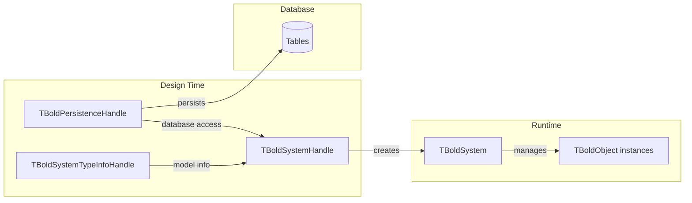
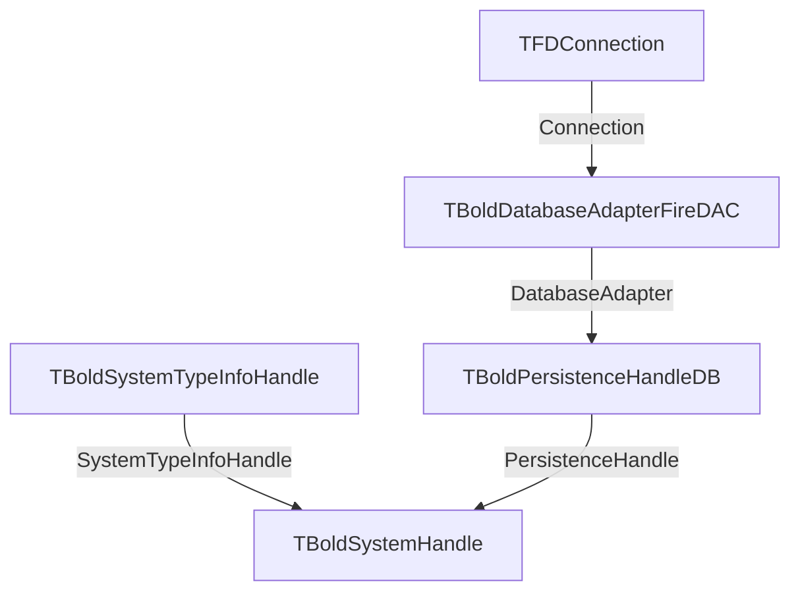

# TBoldSystemHandle

`TBoldSystemHandle` is the component that creates and owns the object space, a `TBoldSystem`. It takes the model
from a `TBoldSystemTypeInfoHandle` and, for a persistent system, the storage from a `TBoldPersistenceHandle`. A
Bold application usually has one on its data module.

## Class Definition

```pascal
TBoldSystemHandle = class(TBoldAbstractSystemHandle)
public
  // Core access
  property System: TBoldSystem;            // nil while inactive
  property Active: Boolean;

  // Database operations
  procedure UpdateDatabase;
  procedure Discard;

  // Configuration
  property AutoActivate: Boolean;
  property Persistent: Boolean;            // read-only: True when PersistenceHandle is set
  property PersistenceHandle: TBoldPersistenceHandle;
  property SystemTypeInfoHandle: TBoldSystemTypeInfoHandle;

  // Events
  property OnPreUpdate: TNotifyEvent;
  property OnOptimisticLockingFailed: TBoldOptimisticLockingFailedEvent;
end;
```

## Component Diagram



## Typical Setup

### Design-Time Configuration

1. Drop a `TBoldSystemHandle` on a data module.
2. Drop a `TBoldSystemTypeInfoHandle` and set its `BoldModel` to your model component.
3. Drop a `TBoldPersistenceHandleDB` and a database adapter, and configure the database.
4. Connect the components as below.



### Runtime Activation

```pascal
procedure TDataModule1.DataModuleCreate(Sender: TObject);
begin
  // Configure the connection
  FDConnection1.Params.Database := 'MyDatabase.db';

  // Activate the system
  BoldSystemHandle1.Active := True;
end;
```

## Properties

### System

The object space. It is `nil` while the handle is inactive.

```pascal
var
  BoldSystem: TBoldSystem;
begin
  BoldSystem := BoldSystemHandle1.System;
  // Work with objects
end;
```

### Active

Setting `Active` to `True` activates the persistence handle, if one is set, and creates the system. Setting it to `False` frees
the system; this raises an exception while the system has unsaved changes, so call `UpdateDatabase` or `Discard`
first.

```pascal
// Activate manually
BoldSystemHandle1.Active := True;

// Check status
if BoldSystemHandle1.Active then
  ShowMessage('System is active');
```

### AutoActivate

When `True`, the handle activates itself when its form or data module is loaded at run time (not in the IDE):

```pascal
// Usually set in the Object Inspector
BoldSystemHandle1.AutoActivate := True;
```

### PersistenceHandle

The persistence handle that reads and writes the objects. Leave it empty for a transient system.

```pascal
BoldSystemHandle1.PersistenceHandle := BoldPersistenceHandleDB1;
```

### SystemTypeInfoHandle

The handle that provides the model information:

```pascal
BoldSystemHandle1.SystemTypeInfoHandle := BoldSystemTypeInfoHandle1;
```

## Methods

### UpdateDatabase

Saves all dirty objects to the database:

```pascal
BoldSystemHandle1.UpdateDatabase;
```

### Discard

Discards all unsaved changes:

```pascal
BoldSystemHandle1.Discard;
```

## Events

### OnPreUpdate

Fires before changes are saved to the database:

```pascal
procedure TForm1.BoldSystemHandle1PreUpdate(Sender: TObject);
begin
  // Validate before save
  ValidateAllChanges;
end;
```

### OnOptimisticLockingFailed

Fires when the objects to save were changed by someone else in the meantime:

```pascal
procedure TForm1.BoldSystemHandle1OptimisticLockingFailed(
  UpdateList, FailureList: TBoldObjectList; const FailureReason: String);
begin
  ShowMessage('Another user modified these objects: ' + FailureReason);
  // Handle the conflict
end;
```

## Common Patterns

### Check for Unsaved Changes

```pascal
function HasUnsavedChanges: Boolean;
begin
  Result := BoldSystemHandle1.System.DirtyObjects.Count > 0;
end;
```

### Save with Confirmation

```pascal
procedure SaveChanges;
begin
  if HasUnsavedChanges then
  begin
    if MessageDlg('Save changes?', mtConfirmation, [mbYes, mbNo], 0) = mrYes then
      BoldSystemHandle1.UpdateDatabase
    else
      BoldSystemHandle1.Discard;
  end;
end;
```

### Graceful Shutdown

```pascal
procedure TDataModule1.DataModuleDestroy(Sender: TObject);
begin
  if BoldSystemHandle1.Active then
  begin
    SaveChanges;
    BoldSystemHandle1.Active := False;
  end;
end;
```

## See Also

- [TBoldSystem](TBoldSystem.md) - The object space
- [TBoldPersistenceHandle](TBoldPersistenceHandle.md) - Database or file access
- [TBoldListHandle](TBoldListHandle.md) - List queries
- [Persistence](../concepts/persistence.md) - Database mapping
- [TBoldSystemHandle in the Class Reference](../reference/BoldSystemHandle/TBoldSystemHandle.md) - All members (2004 help)
