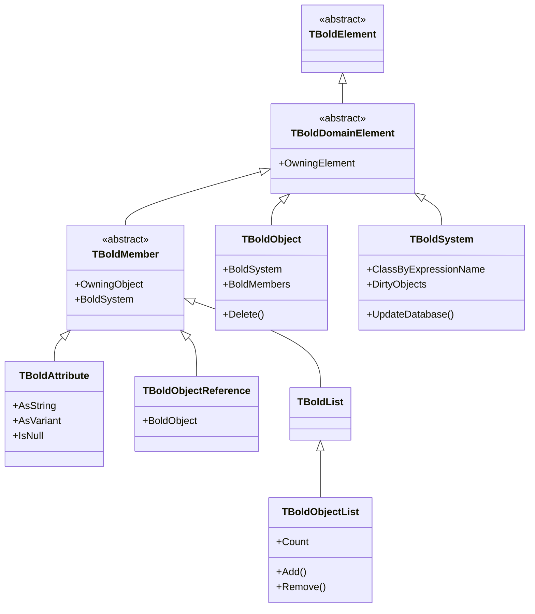
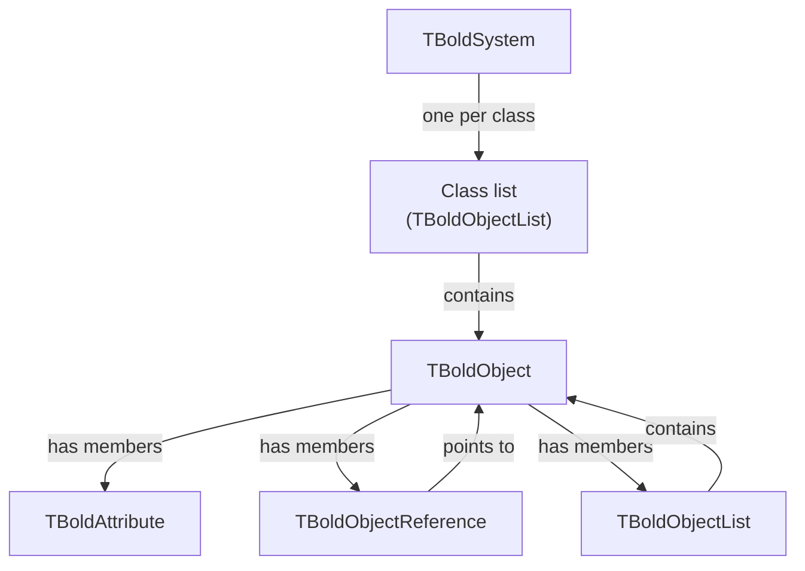

# Class Guides

Hand-written usage guides for the classes you meet most often in Bold for Delphi: what each class is for, how to
use it, and short examples. The full member reference, generated from the original Bold help of 2004, is the
[Class Reference](../reference/index.md).

## Class Hierarchy



## Core Classes

| Class | Description |
|-------|-------------|
| [TBoldElement](TBoldElement.md) | Abstract base class for all Bold elements |
| [TBoldSystem](TBoldSystem.md) | The object space: holds and manages all objects |
| [TBoldObject](TBoldObject.md) | Base class for all domain objects |
| [TBoldObjectList](TBoldObjectList.md) | Collection of Bold objects |
| [TBoldMember](TBoldMember.md) | Base class for attributes and references |
| [TBoldAttribute](TBoldAttribute.md) | Stores attribute values |
| [TBoldObjectReference](TBoldObjectReference.md) | Single-valued associations |

## Attribute Types

| Class | Description |
|-------|-------------|
| [TBAString](TBAString.md) | String attributes (Unicode, ANSI, trimmed, text) |
| [TBAInteger](TBAInteger.md) | Integer attributes (Integer, SmallInt, Word, Byte) |
| [TBAFloat](TBAFloat.md) | Double floating-point attributes |
| [TBACurrency](TBACurrency.md) | Fixed-point currency attributes |
| [TBAMoment](TBAMoment.md) | Date/time attributes (DateTime, Date, Time) |
| [TBABoolean](TBABoolean.md) | Boolean attributes |
| [TBABlob](TBABlob.md) | Binary large object attributes |

## Handle Classes

| Class | Description |
|-------|-------------|
| [TBoldSystemHandle](TBoldSystemHandle.md) | Creates and owns the object space (`TBoldSystem`) |
| [TBoldListHandle](TBoldListHandle.md) | List from an OCL expression, with filtering, sorting and a current element |
| [TBoldExpressionHandle](TBoldExpressionHandle.md) | Single value from an OCL expression |
| [TBoldPersistenceHandle](TBoldPersistenceHandle.md) | Connects the object space to a database or file |

## Subscription and Derivation

| Class | Description |
|-------|-------------|
| [TBoldPublisher](TBoldPublisher.md) | Event sender: holds the subscriptions |
| [TBoldSubscriber](TBoldSubscriber.md) | Event receiver: abstract base |
| [TBoldPassthroughSubscriber](TBoldPassthroughSubscriber.md) | Passes events on to a method |
| [TBoldAbstractDeriver](TBoldAbstractDeriver.md) | Derives values and recalculates them when their sources change |

## Runtime Type Info

| Class | Description |
|-------|-------------|
| [TBoldSystemTypeInfo](TBoldSystemTypeInfo.md) | Model-wide type registry |
| [TBoldClassTypeInfo](TBoldClassTypeInfo.md) | Per-class metadata (members, hierarchy) |
| [TBoldMemberRTInfo](TBoldMemberRTInfo.md) | Per-member metadata (type, persistence, derivation) |

## VCL Controls

These Bold-aware controls are VCL controls (Delphi on Windows). FireMonkey (FMX) and Lazarus (LCL) applications
bind to Bold through `TBoldDataSet` instead.

| Class | Description |
|-------|-------------|
| [TBoldGrid](TBoldGrid.md) | Grid that shows an object list |
| [TBoldEdit](TBoldEdit.md) | Edit box for a single value |
| [TBoldLabel](TBoldLabel.md) | Read-only label |
| [TBoldComboBox](TBoldComboBox.md) | Combo box that picks a value from a list |
| [TBoldCheckBox](TBoldCheckBox.md) | Check box for a Boolean attribute |
| [TBoldNavigator](TBoldNavigator.md) | Navigation and insert/delete buttons for a list |

## Utilities

| Class | Description |
|-------|-------------|
| [TBoldGuard](TBoldGuard.md) | Automatic memory management via interface reference counting |
| [TBoldObjectId](TBoldObjectId.md) | Object identity for persistence |

## Relationship Between Classes



## Common Patterns

### Accessing Objects

```pascal
// From the system handle
var BoldSystem: TBoldSystem := BoldSystemHandle1.System;

// All instances of a class
var Customers: TBoldObjectList := BoldSystem.ClassByExpressionName['Customer'];

// Navigate from an object
var Orders: TBoldObjectList := Customer.Orders;
```

### Modifying Objects

```pascal
// Change an attribute
Customer.Name := 'New Name';

// Add to a list
Customer.Orders.Add(NewOrder);

// Delete an object
Customer.Delete;
```

### Querying Objects

```pascal
var
  ActiveCustomers: TBoldObjectList;
begin
  ActiveCustomers := BoldSystem.EvaluateExpressionAsNewElement(
    'Customer.allInstances->select(active)') as TBoldObjectList;
  try
    // Work with the list
  finally
    ActiveCustomers.Free; // the caller owns the new element
  end;
end;
```
