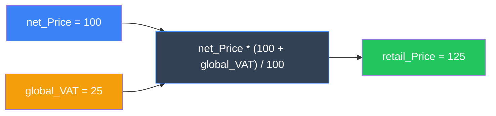
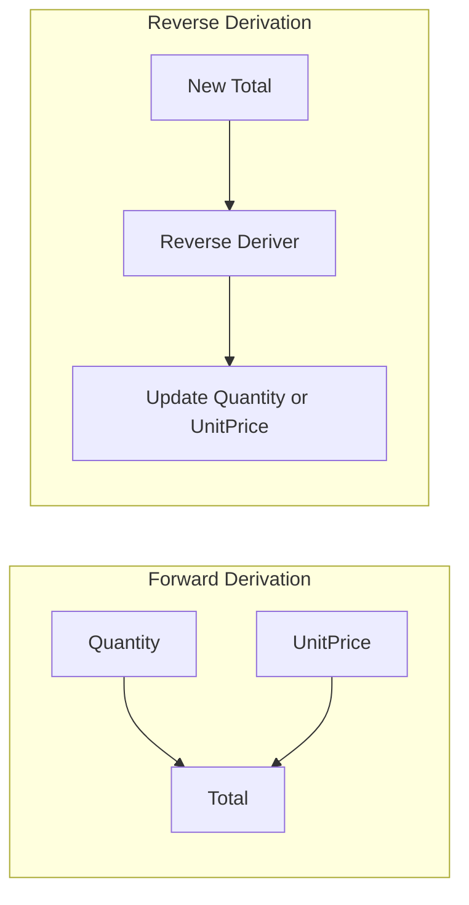

# Derived Attributes

**Values that Bold computes from other values**

## Overview

A derived attribute is computed from other values instead of being set by your code. Common examples are an invoice
total, a full name made of first and last name, or an age computed from a birth date. Because the value can always
be computed again, a derived attribute is normally not stored in the database.

Bold keeps the value current: the derivation subscribes to every value it reads, and when one of them changes, Bold
computes the value again the next time it is read. See [Subscriptions](subscriptions.md) for the mechanism.

Associations can be derived as well: a derived single link or multi link is computed in the same way.

| Concept | Description |
|---------|-------------|
| **OCL derivation** | The derivation is an OCL expression in the model; no code is needed |
| **Code derivation** | The derivation is an Object Pascal method that Bold generates and you implement |
| **Automatic updates** | Derived values are computed again when what they depend on changes |
| **Write protection** | A derived attribute is read-only, unless it is reverse derived |
| **OCL variables** | Expressions can use variables that the application defines |

## OCL or Code?

| Aspect | OCL expression | Object Pascal code |
|--------|----------------|--------------------|
| **Simplicity** | Short expressions in the model | Any logic |
| **Subscriptions** | Placed by Bold | Placed by Bold with AutoSubscription, otherwise by your code (`DefaultSubscribe`); see [Code Derivation](#code-derivation) |
| **Debugging** | Harder to debug | Full debugger support |
| **Where the logic lives** | In the model | In the generated `.inc` file of the business classes |

**Use OCL when** the derivation is a calculation, a navigation, a filter or a count:

| OCL | Derives |
|-----|---------|
| `orderLines->size` | A count |
| `orderLines.amount->sum` | A sum |
| `orders->select(status = 'Active')` | A filtered collection |
| `customer.orders->notEmpty` | A Boolean |

**Use code when** the logic needs intermediate variables, loops, external data, or an algorithm that OCL cannot
express.

## OCL Derivation

An attribute with `Derived` set and the tagged value `Bold.DerivationOCL` holds an OCL expression. Leave
`Persistent` unchecked (`persistence=Transient`), so the attribute has no column in the database.

### Example: Retail Price

The example `examples/Simple/ObjectSpace/DerivedAttributes/` has a class `Product` with `prodName` and `net_Price`,
and a class `GlobalSettings` with a single `vat`. `Product.retail_Price` is a derived Currency attribute:

```ocl
if global_VAT > 0 then net_price * (100 + global_VAT) / 100 else net_Price endif
```



`global_VAT` is not in the model. It is an OCL variable that the application defines in the system's evaluator
when the system opens:

```pascal
AGlobalSetting := BoldSystemHandle1.System.ClassByExpressionName['GlobalSettings'][0]
                    as TGlobalSettings;
if Assigned(AGlobalSetting.M_vat) then
  BoldSystemHandle1.System.Evaluator.DefineVariable('global_VAT',
    AGlobalSetting.M_vat, AGlobalSetting.M_vat.BoldType,
    False,   // OwnValue: the evaluator does not own the member
    False);  // IsConstant
```

The variable is bound to the member `M_vat` itself, so editing the VAT recomputes every retail price.

### Running the Example

The example is a VCL program with only a `.dpr`: open `BE_DerivedAttribDemo.dpr` in the Delphi IDE and let it
create the project. It stores in InterBase through `TBoldDatabaseAdapterIB`, an adapter in `Source/Deprecated`
that is not in the maintained packages, so the search path needs it. Set `IBDatabase1.DatabaseName` first. Then:

1. Press **Create DB**, then **Open system**.
2. Add products with **Add New** and enter net prices.
3. The **Retail Price** column is computed.
4. Change the **VAT** value: every retail price follows.
5. Try to edit a retail price: it is read-only.

The example's `README.md` explains the details, and compares it with the `OclVariables` example, which computes the
same price in the grid column instead.

## Step by Step: Adding a Derived Attribute

This walkthrough adds an attribute `ProjectDuration` to a class `Process`. It computes the number of days between
`StartDate` and `EndDate`.

### Video Walkthrough

<video controls preload="metadata" style="max-width: 100%; border-radius: 8px;">
  <source src="../../assets/videos/derived-workflow.webm" type="video/webm">
  Your browser does not support the video tag.
</video>

*The complete workflow in the model editor*

### 1. Open the Model Editor

Double-click the `BoldModel1` component on your form or data module. The Bold model editor opens.

### 2. Select the Class

In the class tree, select the class, here `Process`.

### 3. Add an Attribute

Right-click the attributes of the class and choose **Add Attribute**, or use the toolbar button.

### 4. Set the Attribute Properties

| Property | Value | Description |
|----------|-------|-------------|
| **Name** | `ProjectDuration` | Attribute name |
| **Type** | `Integer` | Type of the result |
| **Derived** | `True` | The value is computed |
| **Persistent** | `False` | Not stored in the database |

### 5. Enter the Derivation OCL

```ocl
if (self.StartDate.isNull or self.EndDate.isNull) then nil else (self.EndDate - self.StartDate).round endif
```

!!! info "The expression explained"

    - `self.StartDate.isNull`: true when StartDate has no value
    - `self.EndDate - self.StartDate`: subtracting dates gives the number of days as a float
    - `.round`: rounds to the nearest integer
    - `nil`: the result when a date is missing

    The member names start with an uppercase letter, so they follow `self.`: on its own, `StartDate` would be read
    as a class name (see [OCL Queries](ocl.md#basic-syntax)).

### 6. Save and Generate Code

Save the model and generate the business classes again. The derived attribute is ready to use.

### Behavior

=== "Transient (in memory)"

    When `StartDate` or `EndDate` changes, `ProjectDuration` is computed again. Bold-aware UI bound to it updates.

=== "Database"

    With `Persistent=False` the value is not stored; Bold computes it when it is read. Bold also accepts a derived
    attribute marked persistent: when Bold boldifies the model, it adds a private attribute `p_<name>` that is stored
    in the original column. The model validator gives a hint about this combination.

## Code Derivation

For a derived member without a `Bold.DerivationOCL` expression, the code generator writes a method stub that you
implement:

```pascal
procedure TOrder._Total_DeriveAndSubscribe(DerivedObject: TObject; Subscriber: TBoldSubscriber);
```

The method sets the member's value. Who subscribes to the values it reads depends on whether Bold is built with
AutoSubscription:

- **With AutoSubscription**, Bold records every member that the method reads, and when the method returns, it
  subscribes the derivation to each of them. The method needs no `DefaultSubscribe` calls. A changed link or a list
  with a new element needs no special care either: the next derivation reads the new objects, and Bold subscribes to
  them as well.
- **Without AutoSubscription**, the method subscribes itself, by calling `DefaultSubscribe(Subscriber)` on every
  member it reads. Subscribe to a link or list with `breReSubscribe` when the method also subscribes to the objects in
  it: a changed link or a list with a new element then places the subscriptions again. With the default
  `breReEvaluate`, Bold only computes the value again and keeps the old subscriptions.

`bold.inc` turns AutoSubscription off with `NoAutoSubscription` unless `Attracs` is defined, so a build of this
repository runs without it (see [Compiler directives](../development/index.md#compiler-directives)). The examples
below subscribe themselves, so they work in both builds.

### Derived Attributes in Code

```pascal
// Order.Total is derived; Bold generates the method, you write the body
procedure TOrder._Total_DeriveAndSubscribe(DerivedObject: TObject;
  Subscriber: TBoldSubscriber);
var
  Total: Currency;
  Line: TOrderLine;
begin
  // A line added or removed changes what to subscribe to
  M_OrderLines.DefaultSubscribe(Subscriber, breReSubscribe);
  Total := 0;
  for Line in OrderLines do
  begin
    // When a subtotal changes, Total is computed again
    Line.M_Subtotal.DefaultSubscribe(Subscriber);
    Total := Total + Line.Subtotal;
  end;
  M_Total.AsCurrency := Total;
end;
```

### Derived Single Links

A reference to another object that is computed, not stored:

```pascal
// Person.Employer is derived: the company of the active employment
procedure TPerson._Employer_DeriveAndSubscribe(DerivedObject: TObject;
  Subscriber: TBoldSubscriber);
var
  Employment: TEmployment;
begin
  M_Employments.DefaultSubscribe(Subscriber, breReSubscribe);

  for Employment in Employments do
  begin
    Employment.M_Active.DefaultSubscribe(Subscriber);
    if Employment.Active then
    begin
      Employment.M_Company.DefaultSubscribe(Subscriber);
      M_Employer.BoldObject := Employment.Company;
      Exit;
    end;
  end;

  // No active employment
  M_Employer.BoldObject := nil;
end;
```

### Derived Multi Links

A collection computed from other data:

```pascal
// Customer.ActiveOrders is derived: the orders that are not completed or cancelled
procedure TCustomer._ActiveOrders_DeriveAndSubscribe(DerivedObject: TObject;
  Subscriber: TBoldSubscriber);
var
  Order: TOrder;
begin
  M_Orders.DefaultSubscribe(Subscriber, breReSubscribe);

  M_ActiveOrders.Clear;
  for Order in Orders do
  begin
    Order.M_Status.DefaultSubscribe(Subscriber);
    if (Order.Status <> 'Completed') and (Order.Status <> 'Cancelled') then
      M_ActiveOrders.Add(Order);
  end;
end;
```

A derived association can also be defined in OCL: the example `examples/Simple/ObjectSpace/DerivedRelations/` gives
each navigable role a `Bold.DerivationOCL` expression.

## Reverse Derivation

**Reverse derivation** makes a derived attribute writable. Set the tagged value `Bold.ReverseDerive=True` (**Reverse
derived** in the model editor), and the code generator adds a second method. Bold calls it when the derived member
is assigned; the method reads the new value and changes the source values so that the derivation produces it.



### Example: Order Line Total

`OrderLine.Total = Quantity * UnitPrice`. When the user edits the total, the reverse derivation decides which source
to change:

```pascal
// Forward: compute Total from Quantity and UnitPrice
procedure TOrderLine._Total_DeriveAndSubscribe(DerivedObject: TObject;
  Subscriber: TBoldSubscriber);
begin
  M_Quantity.DefaultSubscribe(Subscriber);
  M_UnitPrice.DefaultSubscribe(Subscriber);

  M_Total.AsCurrency := Quantity * UnitPrice;
end;

// Reverse: the user set Total; keep UnitPrice and adjust Quantity
procedure TOrderLine._Total_ReverseDerive(DerivedObject: TObject);
var
  NewTotal: Currency;
begin
  NewTotal := M_Total.AsCurrency;

  if UnitPrice > 0 then
    M_Quantity.AsInteger := Round(NewTotal / UnitPrice)
  else
    M_Quantity.AsInteger := 0;
end;
```

### Example: Full Name

A full name derived from first and last name, with a reverse derivation that splits the input:

```pascal
// Forward: FullName = FirstName + ' ' + LastName
procedure TPerson._FullName_DeriveAndSubscribe(DerivedObject: TObject;
  Subscriber: TBoldSubscriber);
begin
  M_FirstName.DefaultSubscribe(Subscriber);
  M_LastName.DefaultSubscribe(Subscriber);

  M_FullName.AsString := FirstName + ' ' + LastName;
end;

// Reverse: split FullName into FirstName and LastName
procedure TPerson._FullName_ReverseDerive(DerivedObject: TObject);
var
  Parts: TArray<string>;
begin
  Parts := M_FullName.AsString.Split([' '], 2);

  if Length(Parts) >= 1 then
    M_FirstName.AsString := Parts[0];
  if Length(Parts) >= 2 then
    M_LastName.AsString := Parts[1]
  else
    M_LastName.AsString := '';
end;
```

The example `examples/Simple/ObjectSpace/ReverseDerivedAttributes/` shows two reverse derivations, one of which
creates, joins or renames a family from the typed name.

### When to Use Reverse Derivation

| Scenario | Example |
|----------|---------|
| **Editable calculated fields** | The user can edit Total or Quantity |
| **Composite values** | Full name ↔ first and last name |
| **Unit conversions** | Celsius ↔ Fahrenheit |
| **Percentage allocations** | Adjust one item, rebalance the others |

### Considerations

1. **Consistency**: forward and reverse derivation must agree.
2. **Ambiguity**: when several sources could change, the reverse derivation is a policy you choose.
3. **Validation**: check the input in the reverse derivation before applying it.
4. **Loops**: do not trigger derivation cycles.

## Related Topics

- [OCL Queries](ocl.md): the OCL reference
- [Subscriptions](subscriptions.md): how derived values learn about changes
- [Object Space](object-space.md): the in-memory object model
