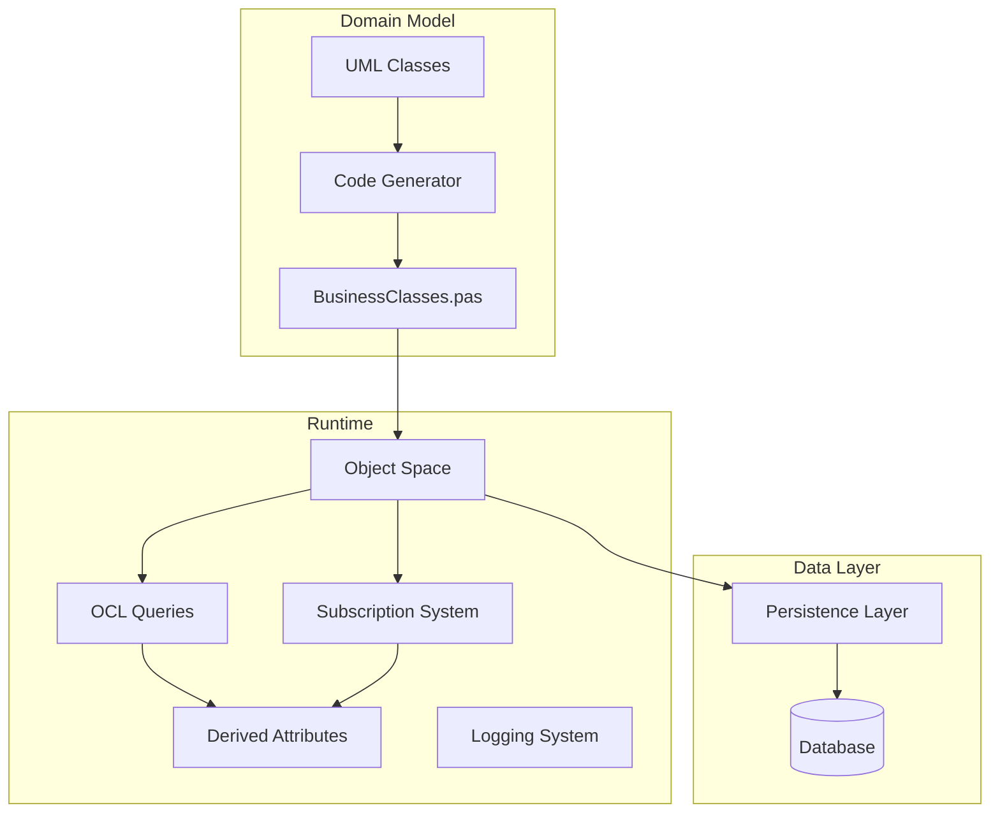

# Core Concepts

Bold for Delphi turns a UML model into a running application. These pages explain the parts it is built from. They
apply to Delphi and to Lazarus / Free Pascal alike unless a page says otherwise.

## Concept Map

## Key Concepts

| Concept | Description | Learn More |
|---------|-------------|------------|
| **Object space** | The in-memory graph of domain objects, managed by `TBoldSystem` | [Object Space](object-space.md) |
| **OCL** | The query language for navigating and filtering objects | [OCL Queries](ocl.md) |
| **Derived attributes** | Members whose value Bold computes from other values, in OCL or in code | [Derived Attributes](derived-attributes.md) |
| **Persistence** | Object-relational mapping to a SQL database, or storage in an XML file | [Persistence](persistence.md) |
| **Subscriptions** | The observer mechanism that keeps derived values and the UI current | [Subscriptions](subscriptions.md) |
| **Logging** | A simple file log, a log with levels and sinks, and a progress log | [Logging](logging.md) |

## The Bold Workflow

1. **Model**: create the UML model with classes, attributes and associations, in the model editor of the Delphi IDE
   or in the standalone model editor (`Tools/ModelEditor`).
2. **Generate**: Bold generates the Object Pascal business classes from the model.
3. **Develop**: write the business logic in the generated classes.
4. **Run**: objects live in the object space and are saved to the database.
5. **React**: subscriptions recompute derived values and update the Bold-aware UI.
