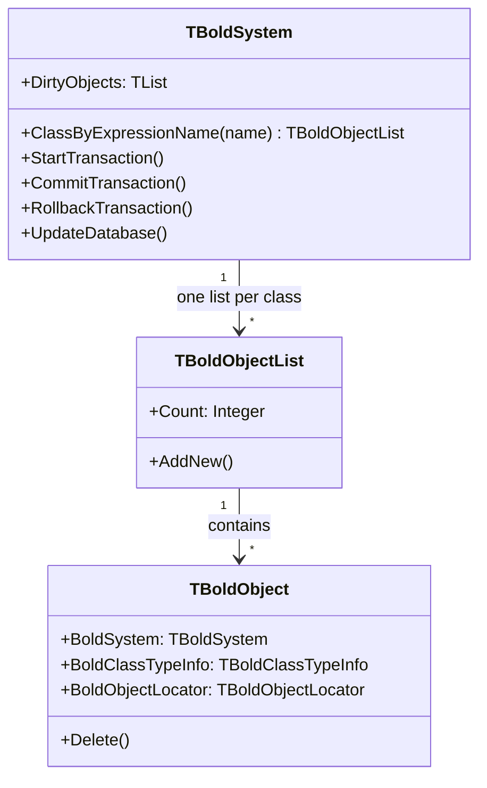
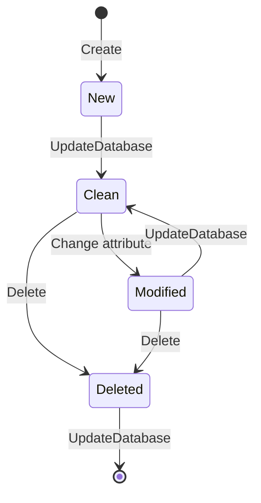

# Object Space

The **object space** holds the domain objects of a running Bold application in memory. A `TBoldSystem` manages it;
a `TBoldSystemHandle` creates the system when it becomes active and gives access to it through its `System`
property. The object space provides:

- Object lifecycle: create, change and delete objects
- Identity: each object has an ID, kept by its `BoldObjectLocator`
- Change tracking: dirty objects, and undo/redo through the undo handler
- Transactions in memory

Changes stay in memory until `UpdateDatabase` saves them through the [persistence layer](persistence.md).

## Architecture



## Working with the Object Space

### Accessing the System

```pascal
var
  System: TBoldSystem;
begin
  System := BoldSystemHandle1.System;
end;
```

### Creating Objects

```pascal
var
  Customer: TCustomer;
begin
  // With the generated class
  Customer := TCustomer.Create(System);

  // By the class name in the model
  Customer := System.CreateNewObjectByExpressionName('Customer') as TCustomer;
end;
```

### Finding Objects

Each class in the model has a **class list** with all its instances. It is the same list as the OCL expression
`Customer.allInstances`.

```pascal
var
  AllCustomers: TBoldObjectList;
  Customer: TBoldObject;
begin
  // All instances of a class
  AllCustomers := System.ClassByExpressionName['Customer'];

  // An object that is already loaded, or nil
  Customer := System.Locators.ObjectByID[SomeId];

  // The object with this ID, fetched from the database if needed
  Customer := System.EnsuredLocatorByID[SomeId].EnsuredBoldObject;
end;
```

`SomeId` is a `TBoldObjectId`. To find objects by their values, use [OCL](ocl.md).

### Deleting and Discarding

`Order.Delete` marks the object as deleted; the next `UpdateDatabase` removes it from the database.
`System.Discard` throws away all changes that are not saved yet.

## Object States

An object's state follows its lifecycle:



| State | Description | How to test it |
|-------|-------------|----------------|
| **New** | Just created, not yet in the database | `BoldObjectIsNew` |
| **Clean** | Matches the database, no pending changes | `not BoldDirty` |
| **Modified** | Has unsaved changes | `BoldDirty` |
| **Deleted** | Marked for deletion, removed by the next `UpdateDatabase` | `BoldObjectIsDeleted` |

The underlying properties are `BoldExistenceState` (`besNotCreated`, `besExisting`, `besDeleted`) and
`BoldPersistenceState` (`bvpsCurrent`, `bvpsModified`, `bvpsInvalid`, `bvpsTransient`).

## Transactions

Object space transactions work in memory. `RollbackTransaction` restores every value that changed since
`StartTransaction`; the database is not involved until `UpdateDatabase`.

```pascal
System.StartTransaction;
try
  Customer.Name := 'New Name';
  Order.Delete;
  System.CommitTransaction;
except
  System.RollbackTransaction;
  raise;
end;
System.UpdateDatabase;
```

`TryCommitTransaction` commits, or rolls back and returns `False` when the commit fails.

### Nested Transactions

Transactions nest, but there are no savepoints: only the outermost level commits or rolls back.

| Call | Outermost level | Inner level |
|------|-----------------|-------------|
| `StartTransaction` | Starts recording old values | Increases `TransactionNesting` |
| `CommitTransaction` | Keeps the changes; raises an exception if the transaction is marked rollback-only | Decreases `TransactionNesting` |
| `RollbackTransaction` | Restores all values recorded since the outermost `StartTransaction` | Marks the whole transaction rollback-only and decreases `TransactionNesting` |

A rollback at an inner level undoes nothing by itself. The outermost `CommitTransaction` then raises, and the
outermost `RollbackTransaction` undoes the changes of all levels. With the `try ... except RollbackTransaction;
raise; end` pattern on every level, an exception at any depth rolls back everything.

Call `UpdateDatabase` after the outermost commit.

## Dirty Objects

Bold tracks which objects have unsaved changes:

```pascal
var
  i: Integer;
begin
  // Are there unsaved changes?
  if System.BoldDirty then
    ShowMessage('You have unsaved changes');

  // The modified objects; DirtyObjects is a TList of TBoldObject
  for i := 0 to System.DirtyObjects.Count - 1 do
    ProcessDirtyObject(TBoldObject(System.DirtyObjects[i]));
end;
```

`System.DirtyObjectsAsBoldList` returns the same objects in a new `TBoldObjectList`, which the caller frees.
