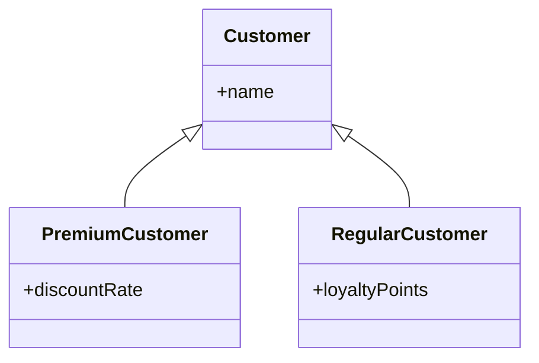

# OCL Queries

**OCL (Object Constraint Language)** is the query language of Bold. It is based on the OMG standard and expresses
navigation, filtering and calculation over the object space declaratively. Bold uses OCL in handles, in derived
attributes and associations, in constraints, and in your own code.

## Basic Syntax

**Class names and member names.** Bold's OCL parser reads a name that starts with an uppercase letter (A to Z) as a
class name, unless it follows a dot. `Customer.allInstances` gets all Customer objects; `self.orders` navigates from
the current object to its orders. Give members names that start with a lowercase letter, or reach them with
`self.` first.

**`.` and `->`.** A dot navigates to a member or applies an operation to a single value (`name.length`,
`orderDate.year`). An arrow applies an operation to a collection (`orders->size`). Navigating from a collection
collects the member of every element: `self.orders.orderLines` gives all order lines of all orders.

### Getting All Instances

```ocl
Customer.allInstances
```

### Navigating Associations

| Expression | Result |
|------------|--------|
| `self.orders` | One customer's orders |
| `self.orders.orderLines` | All order lines of all those orders |

### Filtering with Select

```ocl
Customer.allInstances->select(age > 30)
Customer.allInstances->select(name = 'Acme')
Customer.allInstances->select(c | c.age > 30)
```

Inside `select`, `reject`, `collect`, `exists`, `forAll`, `orderby` and `orderdescending` the members of the current
element can be used directly, as in the first two lines. The third line names the element with a loop variable.

### Checking Existence

```ocl
Customer.allInstances->select(orders->notEmpty)
Customer.allInstances->exists(totalPurchases > 10000)
```

## Common Operations

Operation names are not case sensitive: `orderby` and `orderBy` are the same operation.

### Collection Operations

| Operation | Type | Description | Example |
|-----------|------|-------------|---------|
| `->select(expr)` | Collection | Keep the elements where `expr` is true | `orders->select(total > 100)` |
| `->reject(expr)` | Collection | Drop the elements where `expr` is true | `orders->reject(cancelled)` |
| `->collect(expr)` | Collection | Evaluate `expr` for every element | `orders->collect(total)` |
| `->exists(expr)` | Boolean | True if any element matches | `orders->exists(total > 1000)` |
| `->forAll(expr)` | Boolean | True if all elements match | `orders->forAll(paid)` |
| `->isEmpty` | Boolean | Collection is empty | `orders->isEmpty` |
| `->notEmpty` | Boolean | Collection has elements | `orders->notEmpty` |
| `->size` | Integer | Number of elements | `orders->size` |
| `->first` | Element | First element | `orders->first` |
| `->last` | Element | Last element | `orders->last` |
| `->at(n)` | Element | Element at position `n`, counted from 1 | `orders->at(1)` |
| `->includes(x)` | Boolean | Collection contains `x` | `orders->includes(anOrder)` |
| `->count(x)` | Integer | Number of times `x` occurs | `tags->count('urgent')` |
| `->indexOf(x)` | Integer | Position of `x`, counted from 0; -1 if absent | `orders->indexOf(anOrder)` |

Other collection operations: `includesAll`, `union`, `intersection`, `difference`, `symmetricDifference`,
`including`, `excluding`, `append`, `prepend`, `subSequence`, `asSet`, `asBag`, `asSequence`, `reverseCollection`,
`hasDuplicates`, `filterOnType`, `asCommaText`.

### Aggregation

| Expression | Result |
|------------|--------|
| `orders->collect(total)->sum` | Sum of all totals |
| `orders->collect(total)->average` | Average |
| `orders->collect(total)->maxValue` | Largest value |
| `orders->collect(total)->minValue` | Smallest value |

`max` and `min` compare two values: `a.max(b)`.

### Sorting

```ocl
Customer.allInstances->orderby(name)
Customer.allInstances->orderdescending(createdDate)
```

### Values: Strings, Numbers and Dates

| Kind | Operations |
|------|------------|
| String | `length`, `toUpper`, `toLower`, `subString(from, to)`, `contains`, `trim`, `concat`, `pad`, `postPad`, `sqlLike`, `sqlLikeCaseInsensitive`, `regExpMatch`, `strToInt`, `strToFloat`, `strToDate` |
| Number | `abs`, `floor`, `round`, `div`, `mod`, `power`, `sqrt`, `max`, `min`, `format`, `formatFloat`, `asFloat` |
| Date and time | `year`, `month`, `day`, `week`, `dayOfWeek`, `datePart`, `formatDateTime`, `asISODate`, `asISODateTime`, `secondsBetween`, `minutesBetween`, `hoursBetween`, `inDateRange` |
| Any value | `asString`, `isNull`, `oclType` |

`+` adds numbers and concatenates strings. The variable `today` holds the current date, and `now` the current date and time, rounded to the minute.

### Type Operations

#### Class Hierarchy Example



#### Type Checking Operations

| Expression | Result |
|------------|--------|
| `self.oclIsKindOf(Customer)` | True for Customer, PremiumCustomer and RegularCustomer |
| `self.oclIsTypeOf(Customer)` | True only for an object of exactly the class Customer |
| `self.oclAsType(PremiumCustomer)` | The object as a PremiumCustomer |
| `customers->filterOnType(PremiumCustomer)` | The elements that are PremiumCustomers |

## Using OCL in Code

Every `TBoldElement` (an object, a member, a list or the system itself) can evaluate an expression. The element is
the context, `self`, of the expression.

### Evaluate an Expression

`EvaluateExpressionAsNewElement` returns a new element that the caller frees:

```pascal
var
  Element: TBoldElement;
  Customers: TBoldObjectList;
begin
  Element := BoldSystem.EvaluateExpressionAsNewElement(
    'Customer.allInstances->select(orders->size > 5)');
  try
    Customers := Element as TBoldObjectList;
    // use Customers
  finally
    Element.Free;
  end;
end;
```

### With a Context Object

```pascal
var
  Customer: TCustomer;
  OrderCount: Integer;
begin
  // 'self' is Customer
  OrderCount := Customer.EvaluateExpressionAsInteger('self.orders->size');
end;
```

`EvaluateExpressionAsString`, `EvaluateExpressionAsBoolean`, `EvaluateExpressionAsFloat`,
`EvaluateExpressionAsCurrency` and `EvaluateExpressionAsDateTime` work the same way.

### In Bold Handles

```pascal
// TBoldListHandle - for lists of objects
BoldListHandle1.Expression := 'Customer.allInstances->select(active)';

// TBoldExpressionHandle - for single values
BoldExpressionHandle1.Expression := 'self.orders->collect(total)->sum';
```

See [TBoldListHandle](../classes/TBoldListHandle.md) and [TBoldExpressionHandle](../classes/TBoldExpressionHandle.md)
for more details.

### Evaluating in the Database

By default Bold evaluates OCL in memory and fetches the objects it needs. With `EvaluateInPS` set, Bold translates
the expression to SQL and lets the database evaluate it. Both `TBoldListHandle` and `TBoldExpressionHandle` have an
`EvaluateInPS` property, and the `EvaluateExpression...` methods take it as a parameter.
`TBoldSystem.CanEvaluateInPS` tells whether an expression can be translated.

## Advanced Examples

### Complex Filtering

Customers with at least one order over 1000 this year:

```ocl
Customer.allInstances->select(
  orders->exists(
    (total > 1000) and
    (orderDate.year = today.year)
  )
)
```

### Nested Navigation

All products ordered by premium customers:

```ocl
Customer.allInstances
  ->select(oclIsKindOf(PremiumCustomer))
  ->collect(orders)
  ->collect(orderLines)
  ->collect(product)
  ->asSet
```

### Conditional Logic

```ocl
if self.orders->isEmpty then
  'No orders'
else
  self.orders->size.asString + ' orders'
endif
```
