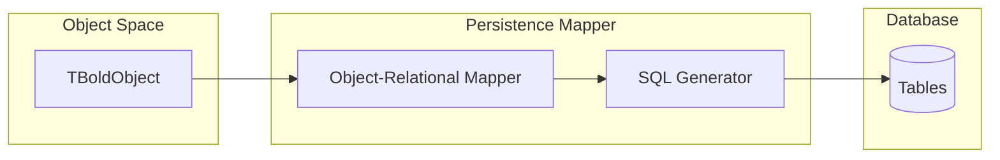
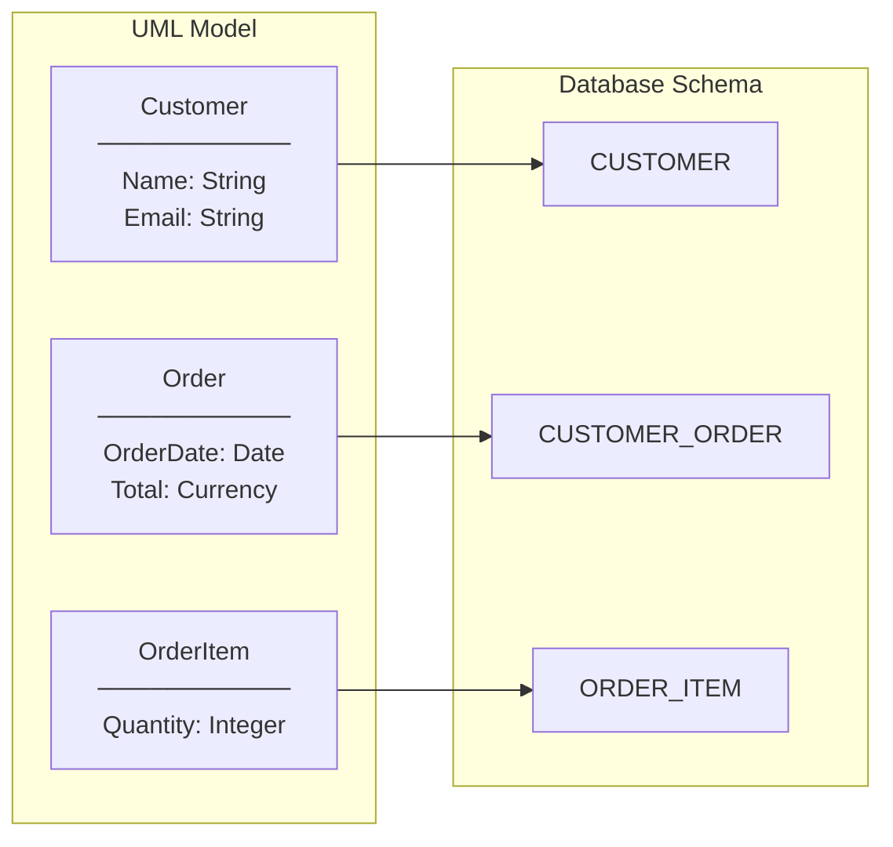
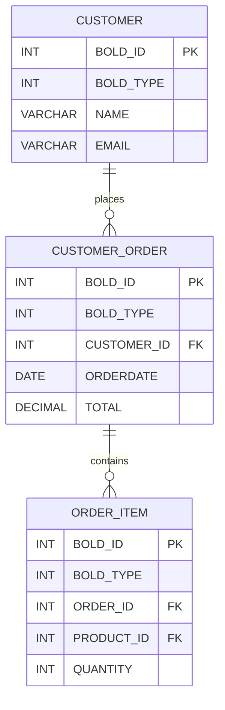

# Persistence

Bold saves the object space to a relational database through **object-relational mapping**, or to an XML file. You
do not write SQL: Bold creates the database schema from the model and generates the statements that fetch and save
objects.

## Architecture



A `TBoldSystemHandle` gets its persistence through its `PersistenceHandle` property:

- For a SQL database, a `TBoldPersistenceHandleDB` with a database adapter, which wraps a connection component of
  the database access library.
- For an XML file, a `TBoldPersistenceHandleFileXML`.

## Adapters

| Toolchain | Library | Adapter | Connection | Notes |
|-----------|---------|---------|------------|-------|
| Delphi | FireDAC | `TBoldDatabaseAdapterFireDAC` | `TFDConnection` | Recommended. Included with Delphi |
| Delphi | UniDAC | `TBoldDatabaseAdapterUniDAC` | `TUniConnection` | Optional. Needs a UniDAC license. Not in the `dclBold` package: use the units in `Source/Persistence/UniDAC` from code |
| Free Pascal | Zeos 8.0 | `TBoldDatabaseAdapterZeos` | `TZConnection` | Lazarus package `BoldZeos` |
| Both | none | `TBoldPersistenceHandleFileXML` | none | XML file, no database server |

The adapter's `DatabaseEngine` property selects the SQL dialect:

| Engine | `DatabaseEngine` | Notes |
|--------|------------------|-------|
| SQLite | `dbeGenericANSISQL92` | Set the text and Int64 column types of `SQLDatabaseConfig`, see below |
| SQL Server | `dbeSQLServer` | |
| PostgreSQL | `dbePostgres` | |
| Firebird, InterBase | `dbeInterbaseSQLDialect3` | |
| Oracle, MySQL | `dbeOracle`, `dbeMySQL` | Not covered by the test suite |

The test suite runs on SQLite, SQL Server and PostgreSQL.

## Configuration

### Delphi with FireDAC

```pascal
// The chain: connection -> adapter -> persistence handle -> system handle
FDConnection1.DriverName := 'SQLite';
FDConnection1.Params.Values['Database'] := 'Invoicing.db';
FDConnection1.LoginPrompt := False;

BoldDatabaseAdapterFireDAC1.Connection := FDConnection1;
BoldDatabaseAdapterFireDAC1.DatabaseEngine := dbeGenericANSISQL92;
// SQLite's own column types for text and 64-bit integers
BoldDatabaseAdapterFireDAC1.SQLDatabaseConfig.ColumnTypeForText := 'TEXT';
BoldDatabaseAdapterFireDAC1.SQLDatabaseConfig.ColumnTypeForUnicodeText := 'TEXT';
BoldDatabaseAdapterFireDAC1.SQLDatabaseConfig.ColumnTypeForAnsiText := 'TEXT';
BoldDatabaseAdapterFireDAC1.SQLDatabaseConfig.ColumnTypeForInt64 := 'INTEGER';

BoldPersistenceHandleDB1.DatabaseAdapter := BoldDatabaseAdapterFireDAC1;
BoldPersistenceHandleDB1.BoldModel := BoldModel1;
BoldSystemHandle1.PersistenceHandle := BoldPersistenceHandleDB1;
```

`dbeGenericANSISQL92` is declared in the unit `BoldSQLDatabaseConfig`. On a form or data module the same properties
are set in the Object Inspector. `examples/Compound/Invoicing/Data/dmInvoicing.pas` is a complete data module.

### Free Pascal with Zeos

The Zeos adapter is used in the same way, with a `TZConnection`:

```pascal
ZConnection1.Protocol := 'sqlite';
ZConnection1.Database := 'Invoicing.db';
BoldDatabaseAdapterZeos1.Connection := ZConnection1;
BoldDatabaseAdapterZeos1.DatabaseEngine := dbeGenericANSISQL92;
```

Set the `SQLDatabaseConfig` column types as for FireDAC. `examples/Compound/Invoicing/Zeos/` is a complete program;
its `README.md` explains how to install Zeos.

### XML File

```pascal
BoldPersistenceHandleFileXML1.BoldModel := BoldModel1;
BoldPersistenceHandleFileXML1.FileName := 'Invoicing.xml';
BoldSystemHandle1.PersistenceHandle := BoldPersistenceHandleFileXML1;
```

XML file persistence suits small programs and tests. `examples/Compound/Invoicing/FPC/` uses it.

## Creating the Database Schema

Bold creates the tables from the model. The persistence handle must be inactive, that is, the system handle is not
active yet:

```pascal
BoldPersistenceHandleDB1.CreateDataBaseSchema;
BoldSystemHandle1.Active := True;
```

`CreateDataBaseSchema(IgnoreUnknownTables)` creates Bold's own tables and one table per class. `CreateDataBase`
creates the database itself, where the adapter supports it. In a VCL application, the action
`TBoldGenerateSchemaAction` does the same from a button or menu.

## Mapping Rules

### Classes to Tables

| UML Element | Database Element |
|-------------|------------------|
| Class | Table, named by the tagged value `TableName` (default: the class name) |
| Attribute | Column, named by the tagged value `ColumnName` (default: the attribute name) |
| Association (1:N) | A column in the table on the N side |
| Association (N:M) | A link table |
| Inheritance | By default one table per class (`TableMapping=Own`); the rows share `BOLD_ID`, and `BOLD_TYPE` holds the class of the object |

### Example Mapping





## Operations

### Save Changes

```pascal
// Save all dirty objects to the database
BoldSystemHandle1.UpdateDatabase;

// Or through the system
BoldSystemHandle1.System.UpdateDatabase;
```

`UpdateDatabaseWithList` and `UpdateDatabaseWithObjects` save only the given objects. Transactions in the object
space are described in [Object Space](object-space.md#transactions).

### Fetch Objects

Bold fetches objects lazily:

```pascal
// Objects are loaded on first access
Customer := Customers[0];  // Fetches from the database if not loaded
Name := Customer.Name;     // The attribute is already loaded
```

### Batch Fetching

To avoid one query per object, fetch related objects for a whole list at once:

```pascal
// Fetch the orders of all customers in the list
BoldSystemHandle1.System.FetchLinksWithObjects(CustomerList, 'orders');

// Fetch some members of all objects in the list
BoldSystemHandle1.System.FetchMembersWithObjects(CustomerList, 'name,email');
```

## Schema Evolution

When the model changes, `TBoldDataBaseEvolutor` (unit `BoldDbEvolutor`) compares the model with the mapping stored
in the database and produces the SQL script that brings the database up to date. The persistence handle must be
inactive.

```pascal
var
  Evolutor: TBoldDataBaseEvolutor;
  SQLScript, MappingScript, Warnings: TStringList;
begin
  Evolutor := TBoldDataBaseEvolutor.Create(BoldPersistenceHandleDB1);
  SQLScript := TStringList.Create;
  MappingScript := TStringList.Create;
  Warnings := TStringList.Create;
  try
    Evolutor.CalculateScript;
    Evolutor.GenerateScript(SQLScript, MappingScript);
    Evolutor.GenerateWarnings(Warnings);
    // Review SQLScript and Warnings before anything runs
    if SQLScript.Count > 0 then
      Evolutor.ExecuteScript;
  finally
    Warnings.Free;
    MappingScript.Free;
    SQLScript.Free;
    Evolutor.Free;
  end;
end;
```

In a Delphi VCL application, `TBoldEvolveDBAction` or `TfrmBoldDbEvolutor.EvolveDB` (unit `BoldDbEvolutorForm`) run
the same steps and show the script and the warnings for review before anything is executed.

The evolutor handles:

- Added and removed classes (tables)
- Added and removed attributes (columns)
- Added and removed associations
- Added and removed indexes
- Data that moves to another table when the mapping changes

A changed attribute type drops the old column and adds a new one: the old values are not converted.
`examples/Compound/ModelEvolution/` shows schema evolution together with upgrading existing objects.

## Performance Tips

1. **Fetch in batches**: use `FetchLinksWithObjects` and `FetchMembersWithObjects` for lists you iterate, to avoid
   one query per object.
2. **Filter in the database**: set `EvaluateInPS` on list handles whose OCL the database can evaluate (see
   [OCL Queries](ocl.md#evaluating-in-the-database)).
3. **Indexes**: Bold creates indexes on `BOLD_ID`, `BOLD_TYPE` and the link columns. Add your own through the
   adapter's `CustomIndexes`.
