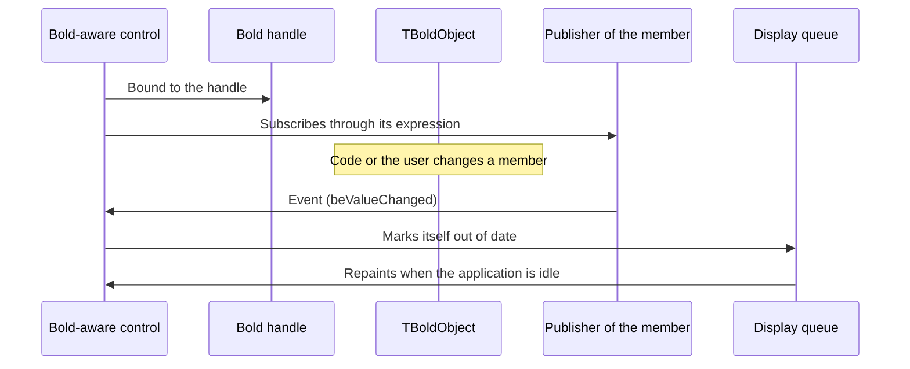
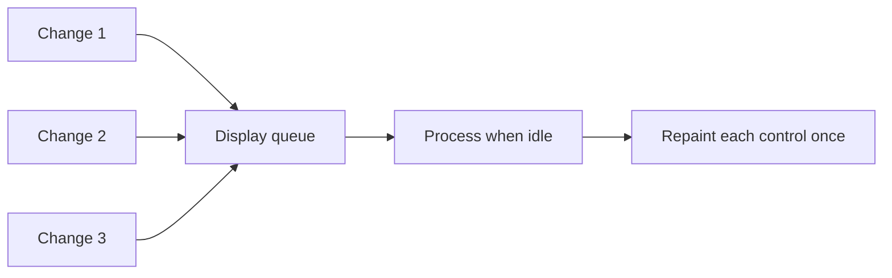

# Subscriptions

Bold uses a **subscription system** (the observer pattern) to tell interested parties when objects change. It keeps
derived values and the user interface current without refresh code.

Every subscribable element (an object, a member, a list, a handle) has a publisher. A subscriber registers with the
publisher for the events it wants; when the element changes, the publisher calls the subscriber at once.

## How It Works



## Subscription Events

The events are constants in the unit `BoldSubscription`. The most common:

| Event | Sent when |
|-------|-----------|
| `beValueChanged` | The value of an attribute or a single link changed |
| `beMemberChanged` | A member of the object changed (sent by the object) |
| `beObjectCreated` | An object was created |
| `beObjectDeleted` | An object was deleted |
| `beItemAdded` | An element was added to a list |
| `beItemDeleted` | An element was removed from a list |
| `beItemReplaced` | An element of a list was replaced |
| `beOrderChanged` | The order of a list changed |
| `beDestroying` | The element is being destroyed |

## Automatic Subscriptions

Bold handles and Bold-aware controls subscribe to what their expressions read:

```pascal
// TBoldEdit subscribes to the attribute its expression reads
BoldEdit1.BoldHandle := CustomerHandle;
BoldEdit1.BoldProperties.Expression := 'name';
// The edit updates when the customer's name changes
```

OCL-derived attributes and associations subscribe in the same way, see [Derived Attributes](derived-attributes.md).

## Manual Subscriptions

For your own logic, subscribe with a `TBoldPassthroughSubscriber`, which calls a method of yours:

```pascal
type
  TMyForm = class(TForm)
    procedure FormCreate(Sender: TObject);
    procedure FormDestroy(Sender: TObject);
  private
    FSubscriber: TBoldPassthroughSubscriber;
    procedure CustomerChanged(Originator: TObject; OriginalEvent: TBoldEvent;
      RequestedEvent: TBoldRequestedEvent);
  end;

procedure TMyForm.FormCreate(Sender: TObject);
begin
  FSubscriber := TBoldPassthroughSubscriber.Create(CustomerChanged);

  // Any member of this customer changes
  Customer.AddSubscription(FSubscriber, beMemberChanged);
  // Or: only the name changes
  Customer.M_Name.DefaultSubscribe(FSubscriber);
end;

procedure TMyForm.CustomerChanged(Originator: TObject; OriginalEvent: TBoldEvent;
  RequestedEvent: TBoldRequestedEvent);
begin
  UpdateCustomerDisplay;
end;

procedure TMyForm.FormDestroy(Sender: TObject);
begin
  // Freeing the subscriber cancels its subscriptions
  FSubscriber.Free;
end;
```

`AddSubscription(Subscriber, OriginalEvent, RequestedEvent)` subscribes to one event; `RequestedEvent` is passed on
to the subscriber and defaults to `breReEvaluate`. `DefaultSubscribe(Subscriber)` subscribes to the events that
mean the element's value changed.

## Re-evaluate or Re-subscribe

Derivers and other subscribers that compute a value distinguish two requested events:

| Requested event | Effect on a deriver |
|-----------------|---------------------|
| `breReEvaluate` (the default) | Computes the value again and keeps the subscriptions |
| `breReSubscribe` | Cancels the subscriptions, then computes the value again and subscribes anew |

Use `breReSubscribe` for a link or list whose elements you also subscribe to. When the link points to another object
or the list gets a new element, the subscriptions must follow:

```pascal
M_Orders.DefaultSubscribe(Subscriber, breReSubscribe);
for Order in Orders do
  Order.M_Status.DefaultSubscribe(Subscriber);
```

## Derivers

**Derivers** compute derived members. A deriver subscribes to every value the derivation reads; when one of them
changes, the derived member is out of date and is computed again when it is read. The derivation is an OCL expression
in the model or an Object Pascal method. [Derived Attributes](derived-attributes.md) covers both, together with
derived links and reverse derivation.

## Display Queue

Subscription events are delivered at once, but Bold-aware controls do not repaint at once. A control that receives
an event marks itself out of date and joins Bold's display queue. The queue is processed later, so a loop that
changes many values repaints each control once:



- In a VCL application, `BoldEnvironmentVCL` processes the queue from the application's idle or message handling.
- In an LCL application, `BoldEnvironmentLCL` processes it when the application is idle.
- Without a GUI framework environment, for example in a console program, the application calls
  `TBoldQueueable.DisplayAll` itself.

Transactions do not delay events: see [Object Space](object-space.md#transactions) for what they do.

## Best Practices

1. **Let Bold subscribe**: use handles and Bold-aware controls where you can.
2. **Free your subscribers**: freeing a subscriber cancels its subscriptions; do it in `OnDestroy`.
3. **Avoid circular dependencies**: they can cause endless recalculation.
4. **Subscribe to what you read**: a deriver that reads a value without subscribing to it shows stale data.
