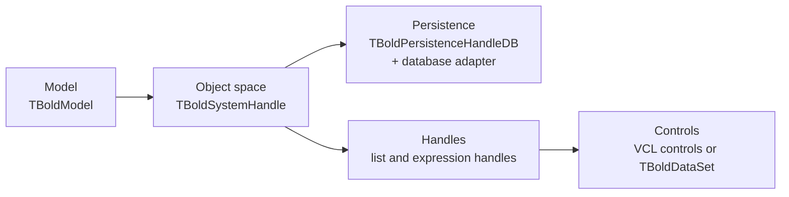

# Getting Started

Bold is model-driven: you describe the business domain as a UML class model, and Bold turns the model into running
code. A Bold application has four layers, and every guide in this section builds the same four:

- The **model** holds the classes, attributes, associations and constraints. Bold generates a Delphi class for each
  model class.
- The **object space** holds the objects at run time and tracks every change.
- **Persistence** maps the objects to database tables (a class to a table, an attribute to a column, an association
  to a foreign key or a link table) and creates the schema from the model.
- **Handles** evaluate OCL expressions against the object space, and **controls** show what the handles hold. When
  an object changes, the handles and controls that depend on it update by themselves.

## Suggested path

1. [Quick Start](../quickstart.md): install Bold and run a ready-made example.
2. [Installation](installation.md): the details for Delphi and for Lazarus.
3. [First Application](first-app.md): build a small application from an empty project.
4. The [Tutorial](https://github.com/bero/BoldForDelphi/tree/develop/examples/Tutorial): a five-step course that
   builds an invoicing application.
5. [Core Concepts](../concepts/index.md), when you want to know how it works inside.
