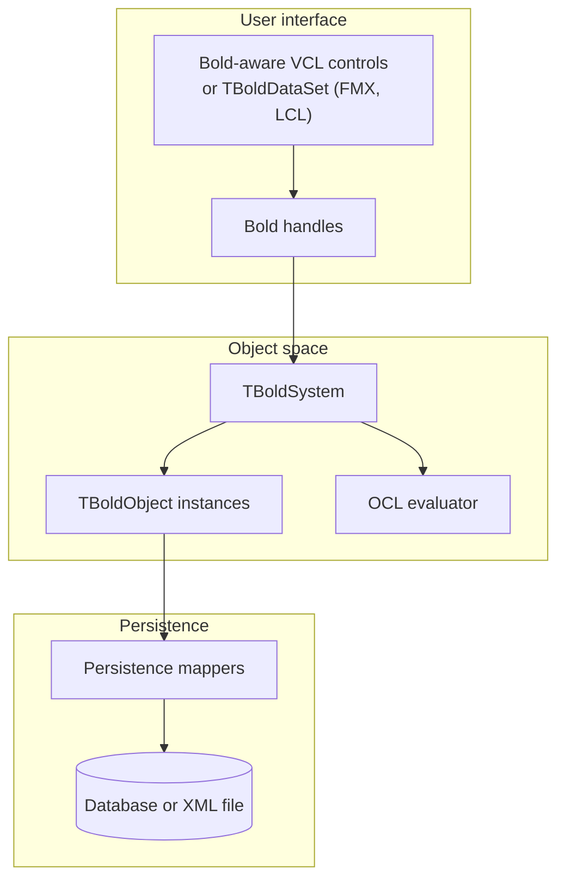

# Bold for Delphi

<!-- The overview below is maintained once, in README.md at the repository root, and included here through
     pymdownx.snippets sections (the start/end markers in README.md). Edit it there. -->

--8<-- "README.md:intro"

## What can I use it for?

--8<-- "README.md:use"

## Most useful features

--8<-- "README.md:features"

## How it compares to what you know

If you have used `TDataSet` with data-aware controls, Bold is the same idea one level up: controls bound to objects
and OCL expressions instead of tables and fields. If you know Hibernate or Entity Framework, Bold is that plus the
derived-value engine and the user interface binding, which those frameworks leave to you.

## Architecture overview

The user interface talks to handles, never to the database. A handle evaluates an OCL expression against the object
space and tells its controls when the result changes. The object space fetches objects through the persistence
mappers when they are first needed, and writes the changed ones back when the application calls `UpdateDatabase`.
[Core Concepts](concepts/index.md) explains each layer.

## Where to start

| You want to | Read |
|-------------|------|
| See Bold running in a few minutes | [Quick Start](quickstart.md) |
| Install Bold in Delphi or Lazarus | [Installation](getting-started/installation.md) |
| Build an application step by step | [First Application](getting-started/first-app.md), then the [Tutorial](https://github.com/bero/BoldForDelphi/tree/develop/examples/Tutorial) |
| Find an example of a feature | [Examples](examples/index.md) |
| Understand how Bold works | [Core Concepts](concepts/index.md) |
| Look up a class | [Class Guides](classes/index.md) and the [Class Reference](reference/index.md) |

The current version and what changed in it are in the [Changelog](changelog.md).

## Community

- [GitHub repository](https://github.com/bero/BoldForDelphi) and [issues](https://github.com/bero/BoldForDelphi/issues)
- [Discord](https://discord.gg/C6frzsn)
- [Bold for Delphi blog](http://boldfordelphi.blogspot.com/)
- [Bold for Delphi wiki](https://delphi.fandom.com/wiki/Bold_for_Delphi)
